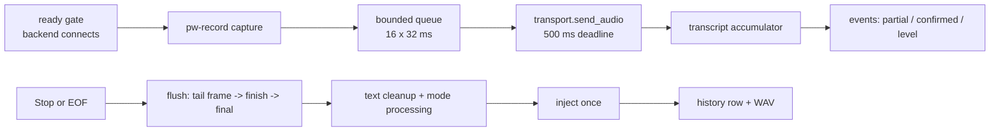

# Voiceless architecture

This document describes how the `voiceless` binary is put together: the
process model, the realtime session pipeline and its invariants, the ASR
backends, text processing and injection, the resident daemon, the web
console, persistence, the model supply chain, quality gates and packaging.
It is the reference for anyone changing the code; the user-facing contract
(commands, configuration keys, console pages) lives in
[`README.md`](../README.md), and the console's HTTP API in
[`console-api.md`](console-api.md). 中文版见
[`architecture.zh.md`](architecture.zh.md).

Module-level details are in the Rust source itself: every module starts
with a `//!` comment that states its purpose and guarantees, and
`cargo doc --no-deps --document-private-items` renders them.

## 1. Design constraints

- **One native binary.** No Python runtime, no desktop shell. Everything a
  session needs (capture, transport, text processing, injection, history)
  is linked into `voiceless`; the only subprocesses are `pw-record`,
  `wtype`/`wl-copy`/`xdotool` for injection, `pw-play` for cues and
  `nvidia-smi` for diagnostics.
- **User data stays in the user's XDG directories**, never in the Nix
  store. Model weights are downloaded on demand and verified; they are not
  part of the repository or the package.
- **Stable identifiers.** CLI commands and flags, TOML keys, JSON event
  fields, model ids and D-Bus names are not translated and not renamed
  silently. Unknown config keys and removed legacy values are errors.
- **Explicit failure.** A backend that cannot open fails the session (or
  falls back once, loudly, to `[asr] fallback_backend`). Audio is never
  dropped or reordered; a full queue fails the session instead.
- **One injection per session, never on cancel.** The final text is typed
  at most once, and a cancelled session types nothing, not even the partial
  text that was already recognized.
- **Old `type4me-linux` directories are never read, moved or deleted.**

## 2. Process model

Voiceless runs in three shapes that share one session implementation:

| Shape | Entry | Control source | Output |
| --- | --- | --- | --- |
| One-shot CLI | `voiceless stream` | SIGINT (first: stop, second: cancel), SIGTERM (cancel), end of capture | stdout/stderr, or JSON lines with `--json`; exit code 0 / 1 / 130 (cancelled) |
| Resident daemon | `voiceless daemon` (systemd user unit from the Home Manager module) | D-Bus `dev.voiceless.Daemon`, evdev push-to-talk key, portal `GlobalShortcuts`, web console | `Event` D-Bus signals (same JSON lines), console SSE, overlay |
| Batch | `voiceless transcribe <wav>`, `voiceless record --seconds N` | none | text, optional injection, history row |

When a daemon is running and `stream` is asked for a local backend, the
CLI does not load a second copy of the model. `ctl::stream_via_daemon`
checks that the daemon owns the bus name and is idle, subscribes to its
`Event` signal, calls `StartSession(mode, inject)`, relays SIGINT/SIGTERM
as `Stop`/`Cancel`, prints the session events exactly like the standalone
sink would, and derives the exit code from the daemon's state transitions.
`--config` or `--backend` disables delegation because the daemon would not
honour them.

## 3. Module map (`rust/src`)

| Layer | Modules | Responsibility |
| --- | --- | --- |
| Entry | `main.rs`, `lib.rs` | clap command tree, exit codes, crate docs |
| Session core | `coordinator.rs`, `session.rs`, `capture.rs`, `stream.rs`, `engine.rs` | `run_session` (the only side-effect boundary), transcript accumulator, `pw-record` capture with `WavRecorder`, backend selection and fallback, injection methods, warm engine handle |
| Streaming backends | `realtime.rs`, `doubao.rs`, `local_asr.rs`, `offline_asr.rs`, `gguf_asr.rs` | DashScope realtime WebSocket, Volcengine Doubao binary protocol, Sherpa-ONNX online Paraformer, VAD-segmented offline decoders (Sherpa offline or transcribe.cpp GGUF) |
| Batch | `batch.rs`, `batch_cmd.rs` | WAV parsing, DashScope multimodal batch, Sherpa SenseVoice |
| Text | `text.rs`, `processing.rs`, `modes.rs` | `[text]` cleanup, LLM modes over OpenAI-compatible or Ollama APIs, mode repository |
| Daemon and desktop | `daemon.rs`, `ctl.rs`, `hotkey.rs`, `media.rs`, `fcitx5.rs`, `doctor.rs` | gateway state machine, D-Bus interface, hotkey gesture machine, portal shortcut, MPRIS pause and cues, Fcitx5 bridge client with ordered preedit, dependency checks |
| Console | `console/mod.rs`, `console/library.rs`, `console/settings.rs`, `assets/console/` | axum router with loopback/token/origin guards, live SSE, history and audio, config read/write, models, modes, diagnostics; embedded single-page app |
| Persistence | `config.rs`, `history.rs`, `models.rs` | strict TOML schema with the 0600 secret gate, SQLite history (schema v2), pinned model catalog with verified installs |
| Quality gates | `benchmark.rs`, `benchmark_cmd.rs`, `latency.rs`, `latency_cmd.rs` | CER replay against the corpus, stage-timestamped latency trials, thresholds and versioned reports |
| CLI adapters | `model_cmd.rs`, `mode_cmd.rs`, `history_cmd.rs` | thin wrappers that print tables or `--json` |

Outside the crate: `fcitx5-bridge/` (C++ Fcitx5 addon), `contrib/eww-overlay/`
(overlay driven by `voiceless ctl watch`), `nix/` (Home Manager module,
bridge package), `scripts/asr_benchmark/` (corpus and TTS generation).

## 4. The realtime session

`coordinator::run_session` owns one session end to end. It is generic over
six traits so the CLI, the daemon and the tests share the same code:

| Trait | Production implementation | Test fake |
| --- | --- | --- |
| `AudioCapture` | `stream::PwCapture` (`pw-record --raw`, 16 kHz mono PCM16, 32 ms chunks), wrapped in `capture::WavRecorder` when audio retention is on | scripted chunk sequences |
| `BackendTransport` | one of the backends in section 5 | scripted `RealtimeEvent`s, blocking sends |
| `TextProcessor` | `stream::PipelineProcessor` (`[text]` cleanup, then the mode's LLM call) | identity / failing processor |
| `TextInjector` | `stream::ConfiguredInjector` | recording injector |
| `HistoryRecorder` | `stream::SqliteHistory` | in-memory list |
| `EventSink` | stdout/JSON sink, daemon broadcast sink, optionally wrapped in `fcitx5::PreeditSink` | collected events |

### 4.1 Lifecycle



1. **Ready gate.** The transport connects and authenticates before capture
   exists (`DEFAULT_READY_TIMEOUT` 5 s). A missing API key or a broken
   model never produces audio.
2. **Capture.** `pw-record` streams raw PCM16; chunks enter a queue of 16
   slots. The coordinator also publishes an RMS level event at most every
   66 ms when a live UI asked for it.
3. **Send.** Each chunk must be accepted by the backend within
   `DEFAULT_SEND_DEADLINE` (500 ms). A full queue or a missed deadline fails
   the session; nothing is dropped or reordered.
4. **Transcript.** `session::RecognitionSession` folds backend events into
   a `TranscriptSnapshot` (`authoritative_text`, `partial_text`,
   `confirmed_segments`, `is_final`) and decides which updates are worth an
   event.
5. **Stop.** Normal stop runs in a fixed order: stop accepting chunks →
   stop capture (SIGINT to `pw-record`) → drain the queue FIFO plus the
   aligned tail frame → exactly one `finish` → wait for the final event
   (`finish_timeout`, 2 s; 20 s for `local-offline`, whose final waits for
   the last segment decode) → text processing → at most one injection →
   history. Empty text completes with a warning and no injection.
6. **Cancel.** Second SIGINT, SIGTERM or daemon `Cancel`: capture and
   backend are aborted, a `cancelled` event is published, and nothing is
   processed, injected or recorded. The partial WAV is deleted.

### 4.2 Events

The sink receives `OutputEvent`s; the JSON sink prints one object per line
with a `type` field: `ready`, `level` (`rms`), `transcript`
(`transcript` snapshot), `finalized` (`injection` result or `null`),
`warning`, `error`, `cancelled`, `completed`. The daemon adds
`state`, `session` (metrics) and `log` lines. `voiceless ctl watch`, the
overlay and the console all consume this schema, so a new event type must
be added to the README table and `docs/console-api.md`.

### 4.3 Audio retention

`WavRecorder<C>` decorates any `AudioCapture`: it mirrors every chunk into
`<data>/audio/<id>.wav.partial`, finalizes the RIFF header and renames on
success, and deletes the partial file on cancel, failure, empty text or
drop. A mirror failure only disables saving for that session. The history
row stores `audio_path` and `duration_seconds`; deleting the row deletes
the file.

## 5. Backends

| `streaming_backend` | Module | Reads | Model | Partial / confirmed |
| --- | --- | --- | --- | --- |
| `cloud-realtime` (default) | `realtime.rs` | `[cloud] api_key`, `realtime_endpoint`, `realtime_model` | DashScope `qwen3-asr-flash-realtime` | server deltas / server commits |
| `doubao-realtime` | `doubao.rs` | `[doubao]` (`api_key` or `app_key`+`access_key`, `resource_id`, ITN/punctuation/DDC flags, hotwords) | Volcengine Seed ASR bigmodel | per-utterance results; optional second-pass `enable_nonstream` |
| `local-streaming` | `local_asr.rs` | `[asr] local_model_dir` or the managed model | Sherpa-ONNX `streaming-paraformer-bilingual-zh-en` | online recognizer partials / endpoint-detected finals |
| `local-offline` | `offline_asr.rs` (+ `gguf_asr.rs` with the `transcribe` feature) | `[local] model`, `provider`, `num_threads`, `partial_interval_ms`, `max_segment_seconds`, hotwords | `qwen3-asr-1.7b-gguf` / `qwen3-asr-0.6b-gguf` on CUDA via transcribe.cpp, or `qwen3-asr-0.6b-int8` / `sense-voice-int8` on CPU via Sherpa-ONNX | re-decoded open segment every `partial_interval_ms` / final decode of each VAD-closed segment |

Batch (`[asr] batch_backend`): `cloud` uses the DashScope multimodal API,
`local` uses Sherpa-ONNX SenseVoice. `transcribe` and `record` share
`batch.rs`.

### 5.1 Fallback

`stream::run_with_env` opens the primary backend; if that fails and
`[asr] fallback_backend` names a different backend, it emits a `warning`
event and opens the fallback once. Missing-model errors are reported as an
`error` event followed by `completed` with exit code 1, so JSON consumers
and overlays see them; configuration errors abort the command. Backends
never fall back internally.

### 5.2 `local-offline` in detail

Silero VAD (512-sample windows) splits the stream at pauses. Ten windows
of pre-roll are kept so the first syllable is not clipped. Every closed
segment is decoded once and published as confirmed text; the open segment
is re-decoded every `partial_interval_ms` for the live partial. A segment
longer than `max_segment_seconds` (default 30 s for GGUF, 15 s for Sherpa)
is force-closed. Decoding runs on a dedicated worker thread so a slow
decode never stalls capture; audio queued meanwhile is coalesced before the
next partial. Context-aware decoders receive the last 120 characters of
confirmed text to keep segments coherent. `[text] hotwords` are merged
into the recognizer's hotword list for models that support biasing.

### 5.3 Warm engine

`engine::WarmEngine` is loaded once by the daemon (`spawn_blocking`) and
lent to each session through `stream::SessionEnv`. A session reuses it only
when model, device, thread count and hotwords match the current config;
otherwise it loads cold on the worker. The daemon verified the model files
at load, so warm sessions skip the per-session hash check of 1–2 GB of
weights. `POST /api/engine/reload` releases the old engine first so its
VRAM is free for the new one.

## 6. Text pipeline

1. **`text::TextCleaner`** runs on every final result, in this order:
   filler removal (all `呃`, and `嗯` when it stands alone, with punctuation
   repair), pinyin-based hotword correction (Chinese hotwords of ≥ 2
   characters; candidate spans are compared syllable by syllable, common
   confusions such as zh/z, n/l and front/back nasals score 0.8, and a span
   is replaced when its score reaches `hotword_threshold`), exact
   `replacements` in order, regex `rules` in order, then the optional
   trailing-period strip.
2. **Modes.** `quick` injects the cleaned text. `voice-polish`,
   `prompt-optimize`, `translate-en` and user-defined modes send it to
   `[processing]` (`openai-compatible` or `ollama`) with the mode's prompt
   template (`{text}` placeholder; `[processing] prompt` overrides the
   prompt-optimize template). A processing failure keeps the cleaned text
   and emits a warning. Modes live in `<config>/modes.json`; built-ins
   cannot be deleted.
3. **History** records raw, processed and final text, the mode, backend
   and model, only for successful sessions.

## 7. Injection

`[inject] prefer` selects the method; `clipboard_fallback = true` retries
with the clipboard when `wtype` or `fcitx5` fails. `timeout_seconds`
bounds every external command.

- **`wtype`**: Wayland virtual keyboard, text split into `wtype`
  invocations (`stream::wtype_invocations`).
- **`clipboard`**: read the current clipboard, `wl-copy` the text, run
  `focus_command` if set, send the paste chord through `paste_tool`
  (`wtype` or `xdotool` with `paste_command`), optionally mirror to the X11
  clipboard (`x11_clipboard_command`, for rootless Xwayland), then restore
  the previous clipboard. Applications whose input method re-interprets
  key events (XWayland IME apps) receive clean text this way.
- **`fcitx5`**: `fcitx5::Fcitx5Client` is an actor owning one D-Bus
  connection to `org.fcitx.Fcitx5` at `/voiceless`
  (`dev.voiceless.Fcitx5Bridge1`). Requests are applied strictly in order
  and consecutive preedit updates collapse to the newest, so a stale
  preedit can never land after the commit that replaced it. With
  `preedit = true`, `PreeditSink` wraps the event sink and shows each
  partial as underlined preedit in the focused field; `CommitString`
  replaces it with the final text. The bridge (`fcitx5-bridge/`) is a
  small Fcitx5 addon that commits into the most recent focused input
  context and reports the target program.

## 8. The daemon

`daemon::serve` loads config, loads the warm engine, starts the session
metrics tracker, starts the console if `[console] enabled`, then runs the
gateway loop.

- **Gateway.** `Gateway<R: SessionRunner>` holds at most one session.
  States: `idle` → `recording` (start) → `stopping` (normal stop) → `idle`
  (session task finished). `activate`/`toggle` start when idle, stop when
  recording and are rejected while stopping; `start`/`stop` are the
  hold-to-talk press/release; `cancel` aborts from any active state.
- **Command sources** feed one `DaemonCommand` channel: the D-Bus interface
  `dev.voiceless.Daemon.Controller` at `/dev/voiceless/Daemon` (`Activate`,
  `Toggle(mode)`, `Start(mode)`, `StartSession(mode, inject)`, `Stop`,
  `Cancel`, `Status`), the evdev listener, the portal shortcut and the
  console's `/api/session/*` endpoints.
- **Hotkey gestures.** `hotkey::listen` watches every keyboard that has
  `[hotkey] key` (read-only, never grabbed; needs the `input` group),
  follows hotplug through an inotify watch on `/dev/input` (a replugged or
  re-enumerated keyboard is picked up again) and reports presses with Ctrl
  state. `daemon::HotkeyMachine` turns them into
  gestures: a press while idle starts a session (`ctrl_mode` when Ctrl is
  held, else `mode` or the daemon default); releasing after
  `hold_threshold_ms` stops it (hold-to-talk); releasing earlier keeps
  recording until the next press (tap-to-toggle); any press while
  recording stops.
- **Portal.** `GlobalShortcuts` is best effort: when the compositor has no
  portal backend the daemon logs it and relies on compositor bindings that
  call `voiceless ctl`.
- **Events.** Every session event is broadcast on a channel; the D-Bus
  task forwards each line as an `Event` signal, the console as SSE, and
  `track_sessions` derives per-session metrics (audio seconds,
  stop-to-final latency, characters) published as `session` events and in
  `Status`.
- **Session side effects.** With `[audio] pause_media` the session pauses
  every playing MPRIS player and resumes exactly those afterwards;
  `[audio] cues` plays start/stop sounds through `pw-play`.
- **Reload.** `POST /api/engine/reload` re-reads config, reloads the engine
  and restarts the hotkey listener without restarting the process.

## 9. Web console

`console::serve_daemon` (full API) and `console::serve_standalone`
(`voiceless history serve`: everything except live control, which answers
503) share one axum router. Guards, in order: the `Host` header must be
loopback on the served port (421 otherwise, blocks DNS rebinding); every
`/api/*` request must carry the per-start random token, as a header or as
`?token=` for `EventSource` and `<audio>` URLs (403 otherwise; the token is
embedded in the page, which cross-site documents cannot read); mutating
requests with an `Origin` must come from the console's own origin. Secrets
are write-only. Settings are patched into `config.toml` with `toml_edit`
so comments survive, validated with the normal loader before writing, and
the response says whether the engine must be reloaded. The page is a
dependency-free single-page app embedded with `include_str!`. Routes are
listed in [`console-api.md`](console-api.md).

## 10. Persistence and XDG layout

```text
config  ${XDG_CONFIG_HOME:-~/.config}/voiceless/     config.toml (0600 when it holds a key), modes.json
data    ${XDG_DATA_HOME:-~/.local/share}/voiceless/  history.sqlite3 (WAL, 0600), audio/<id>.wav, models/
cache   ${XDG_CACHE_HOME:-~/.cache}/voiceless/       model-downloads/
```

- **Config** (`config.rs`): sections `asr`, `cloud`, `doubao`, `local`,
  `text`, `hotkey`, `audio`, `console`, `inject`, `processing`, `history`,
  all optional with defaults; `deny_unknown_fields` everywhere. Legacy
  values (`cloud-vad`, `sensevoice-vad`, `final_backend`) are rejected
  with a message rather than rewritten. A file containing an API key must
  be mode 0600 or stricter. `local_engine()` and `doubao_engine()` merge
  `[text] hotwords` into the recognizer hotwords.
- **History** (`history.rs`): table `recognition_history` (id, created_at,
  duration_seconds, raw_text, processing_mode, processed_text, final_text,
  status, character_count, asr_provider, asr_model, audio_path). Schema
  version is `PRAGMA user_version`; v1 databases gain `audio_path` on open.
  Cursor pagination, totals and per-day usage back the CLI and the
  console.
- **Models** (`models.rs`): `models/versions/<id>/<version>-<digest12>/`
  holds the payload plus `manifest.json`; `models/<id>/current` is a
  symlink swapped atomically on activation.

## 11. Model supply chain

| Id | What | Runs on | Used by |
| --- | --- | --- | --- |
| `streaming-paraformer-bilingual-zh-en` | Sherpa-ONNX online Paraformer | CPU | `local-streaming` |
| `qwen3-asr-1.7b-gguf` | Qwen3-ASR 1.7B, Q8_0 GGUF | CUDA (transcribe.cpp) | `local-offline` (default) |
| `qwen3-asr-0.6b-gguf` | Qwen3-ASR 0.6B, Q8_0 GGUF | CUDA (transcribe.cpp) | `local-offline` |
| `qwen3-asr-0.6b-int8` | Qwen3-ASR 0.6B int8 ONNX | CPU (Sherpa-ONNX) | `local-offline` |
| `sense-voice-int8` | SenseVoice int8 ONNX | CPU (Sherpa-ONNX) | `local-offline`, batch `local` |
| `silero-vad` | Silero VAD ONNX | CPU | `local-offline` segmentation |

Every entry pins URL, byte size, SRI SHA-256, archive type, member
allow-list, required paths and a `license_status` string. `ModelManager::
install` downloads over HTTPS into the cache dir with progress, checks the
size and hash, rejects any archive member outside the allow-list, writes
the manifest and activates by rename plus symlink swap. `check` re-verifies
an installed model; the CLI and every cold session call it before use.

## 12. Quality gates

| Gate | Command | Threshold | Measured 2026-08-15 |
| --- | --- | --- | --- |
| Cloud CER (test split) | `benchmark asr --enforce` | ≤ 0.02 | 0.0070 (12 samples) |
| First partial p95 | `benchmark latency --enforce` | ≤ 1.0 s | 0.422 s |
| Stop → final p50 | same | ≤ 0.6 s | 0.252 s |
| Stop → inject p99 | same, `--inject` | ≤ 1.0 s | 0.535 s (100 trials, quick mode, wtype) |

Reports are written under `scripts/asr_benchmark/reports/`. Without
credentials, models or a Wayland session the commands exit 2 and mark the
report `unverified`; they never report a pass they did not measure.

## 13. Packaging

- **Flake outputs** (`flake.nix`): `packages.voiceless` (default; CUDA
  stack with transcribe.cpp built for `cudaArchitectures = "86"`, adjust for
  other GPUs), `packages.voiceless-cpu` (what CI builds and tests),
  `packages.voiceless-fcitx5-bridge`, `checks.default` (CPU package tests
  including doctests), `devShells.default` / `.cpu`, `overlays.default`,
  `homeManagerModules.default`. The binary is wrapped with `pipewire`,
  `wtype` and `wl-clipboard` on `PATH` and the Sherpa/ONNX runtime on
  `LD_LIBRARY_PATH`; the CUDA ONNX provider is patched to link NVRTC.
- **Home Manager module** (`nix/home-manager.nix`): `programs.voiceless`
  installs the package, generates `config.toml` from `settings`, and
  optionally enables `voiceless.service` (the daemon),
  `voiceless-overlay-eww.service` plus `voiceless-overlay.service` (the
  overlay watcher running `voiceless ctl watch`), and a Sway binding.
- **Fcitx5 bridge** (`nix/fcitx5-bridge.nix`): built against the
  consumer's nixpkgs so the addon matches the running Fcitx5 ABI; add
  `pkgs.voiceless-fcitx5-bridge` to `i18n.inputMethod.fcitx5.addons`.

## 14. Testing

`rust/tests/` holds integration tests that drive `run_session`, the
gateway, the console and the protocols with the fakes in
`tests/common/mod.rs`: scripted captures, transports that block or fail on
demand, recording injectors and in-memory history. Protocol tests replay
captured frames. Tests prefixed `real_` touch installed models or services
and skip when they are absent. `scripts/fcitx5-bridge-test.sh` starts a
private D-Bus session with a real Fcitx5 and exercises the bridge end to
end. CI (`.github/workflows/ci.yml`) runs `cargo fmt --check`,
`cargo test --all-targets` in the CPU shell and `nix flake check`.

## 15. Migration from type4me-linux

Voiceless only touches `voiceless`-named XDG directories. Configuration,
models and history of the old Python tool are left in place; the README
lists the manual steps and the rollback.
