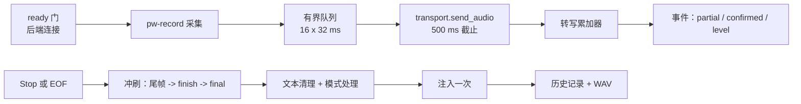

# Voiceless 架构

本文描述 `voiceless` 二进制的组成：进程模型、实时会话管道及其不变量、ASR
后端、文本处理与注入、常驻 daemon、Web 控制台、持久化、模型供应链、质量门禁
和打包。它是改代码的人的参考；面向用户的契约（命令、配置键、控制台页面）在
[`README.zh.md`](../README.zh.md)，控制台 HTTP API 在
[`console-api.md`](console-api.md)。English edition:
[`architecture.md`](architecture.md).

模块级细节在 Rust 源码里：每个模块开头的 `//!` 注释说明它的职责和保证，
`cargo doc --no-deps --document-private-items` 可以渲染出来。

## 1. 设计约束

- **单个原生二进制。** 没有 Python 运行时，没有桌面外壳。会话需要的一切
  （采集、传输、文本处理、注入、历史）都链接进 `voiceless`；唯一的子进程是
  `pw-record`、注入用的 `wtype`/`wl-copy`/`xdotool`、提示音用的 `pw-play`，
  以及诊断用的 `nvidia-smi`。
- **用户数据留在用户的 XDG 目录**，永不进 Nix store。模型权重按需下载并校验，
  不随仓库或软件包分发。
- **稳定标识。** CLI 命令与选项、TOML 键、JSON 事件字段、模型 ID 与 D-Bus
  名称不翻译、不静默重命名。未知配置键与已移除的旧值直接报错。
- **显式失败。** 打不开的后端让会话失败（或者只向 `[asr] fallback_backend`
  明确地回退一次）。音频永不丢弃或重排；队列满了就让会话失败。
- **一次会话最多注入一次，取消绝不注入。** 最终文本最多上屏一次，取消的会话
  什么都不输入，连已经识别出来的部分文本也不输。
- **旧的 `type4me-linux` 目录永不读取、移动或删除。**

## 2. 进程模型

Voiceless 有三种运行形态，共享同一套会话实现：

| 形态 | 入口 | 控制来源 | 输出 |
| --- | --- | --- | --- |
| 一次性 CLI | `voiceless stream` | SIGINT（第一次停止、第二次取消）、SIGTERM（取消）、采集结束 | stdout/stderr，或 `--json` 的 JSON 行；退出码 0 / 1 / 130（取消） |
| 常驻 daemon | `voiceless daemon`（Home Manager 模块生成的 systemd 用户单元） | D-Bus `dev.voiceless.Daemon`、evdev 按住说话键、门户 `GlobalShortcuts`、Web 控制台 | `Event` D-Bus 信号（同样的 JSON 行）、控制台 SSE、浮层 |
| 批量 | `voiceless transcribe <wav>`、`voiceless record --seconds N` | 无 | 文本、可选注入、历史记录 |

daemon 在运行且 `stream` 要用本地后端时，CLI 不会再加载第二份模型。
`ctl::stream_via_daemon` 确认 daemon 持有总线名且空闲，订阅它的 `Event`
信号，调用 `StartSession(mode, inject)`，把 SIGINT/SIGTERM 转发为
`Stop`/`Cancel`，像独立 sink 一样打印会话事件，并从 daemon 的状态变化推导
退出码。带 `--config` 或 `--backend` 时不委托，因为 daemon 不会遵守它们。

## 3. 模块地图（`rust/src`）

| 层 | 模块 | 职责 |
| --- | --- | --- |
| 入口 | `main.rs`、`lib.rs` | clap 命令树、退出码、crate 文档 |
| 会话核心 | `coordinator.rs`、`session.rs`、`capture.rs`、`stream.rs`、`engine.rs` | `run_session`（唯一的副作用边界）、转写累加器、带 `WavRecorder` 的 `pw-record` 采集、后端选择与回退、注入方式、热引擎句柄 |
| 流式后端 | `realtime.rs`、`doubao.rs`、`local_asr.rs`、`offline_asr.rs`、`gguf_asr.rs` | DashScope 实时 WebSocket、火山引擎豆包二进制协议、Sherpa-ONNX 在线 Paraformer、VAD 分段的离线解码器（Sherpa 离线或 transcribe.cpp GGUF） |
| 批量 | `batch.rs`、`batch_cmd.rs` | WAV 解析、DashScope 多模态批量、Sherpa SenseVoice |
| 文本 | `text.rs`、`processing.rs`、`modes.rs` | `[text]` 清理、经 OpenAI 兼容或 Ollama API 的 LLM 模式、模式仓库 |
| daemon 与桌面 | `daemon.rs`、`ctl.rs`、`hotkey.rs`、`media.rs`、`fcitx5.rs`、`doctor.rs` | gateway 状态机、D-Bus 接口、热键手势机、门户快捷键、MPRIS 暂停与提示音、带有序预编辑的 Fcitx5 桥接客户端、依赖检查 |
| 控制台 | `console/mod.rs`、`console/library.rs`、`console/settings.rs`、`assets/console/` | 带回环/令牌/来源守卫的 axum 路由、实时 SSE、历史与音频、配置读写、模型、模式、诊断；内嵌单页应用 |
| 持久化 | `config.rs`、`history.rs`、`models.rs` | 带 0600 密钥门禁的严格 TOML schema、SQLite 历史（schema v2）、带校验安装的固定模型目录 |
| 质量门禁 | `benchmark.rs`、`benchmark_cmd.rs`、`latency.rs`、`latency_cmd.rs` | 对语料回放的 CER、分阶段打时间戳的延迟试验、阈值与版本化报告 |
| CLI 适配 | `model_cmd.rs`、`mode_cmd.rs`、`history_cmd.rs` | 打印表格或 `--json` 的薄封装 |

crate 之外：`fcitx5-bridge/`（C++ Fcitx5 插件）、`contrib/eww-overlay/`
（由 `voiceless ctl watch` 驱动的浮层）、`nix/`（Home Manager 模块、桥接包）、
`scripts/asr_benchmark/`（语料与 TTS 生成）。

## 4. 实时会话

`coordinator::run_session` 端到端地拥有一次会话。它对六个 trait 泛型，所以
CLI、daemon 和测试共用同一份代码：

| Trait | 生产实现 | 测试 fake |
| --- | --- | --- |
| `AudioCapture` | `stream::PwCapture`（`pw-record --raw`，16 kHz 单声道 PCM16，32 ms 块），开启录音保留时外包一层 `capture::WavRecorder` | 脚本化的块序列 |
| `BackendTransport` | 第 5 节的某个后端 | 脚本化的 `RealtimeEvent`、可阻塞的发送 |
| `TextProcessor` | `stream::PipelineProcessor`（先 `[text]` 清理，再模式的 LLM 调用） | 恒等 / 失败处理器 |
| `TextInjector` | `stream::ConfiguredInjector` | 记录型注入器 |
| `HistoryRecorder` | `stream::SqliteHistory` | 内存列表 |
| `EventSink` | stdout/JSON sink、daemon 广播 sink，可选外包 `fcitx5::PreeditSink` | 收集事件 |

### 4.1 生命周期



1. **ready 门。** 传输层在采集存在之前完成连接与鉴权（`DEFAULT_READY_TIMEOUT`
   5 秒）。缺 API key 或模型损坏永远不会产生音频。
2. **采集。** `pw-record` 输出原始 PCM16；块进入 16 槽队列。有实时 UI 要求时，
   coordinator 还会以至多每 66 ms 一次的频率发布 RMS 音量事件。
3. **发送。** 每块必须在 `DEFAULT_SEND_DEADLINE`（500 ms）内被后端接受。队列满
   或超过截止时间都让会话失败；不丢块、不重排。
4. **转写。** `session::RecognitionSession` 把后端事件折叠成
   `TranscriptSnapshot`（`authoritative_text`、`partial_text`、
   `confirmed_segments`、`is_final`），并决定哪些更新值得发一个事件。
5. **停止。** 正常停止按固定次序：停止接受新块 → 停止采集（给 `pw-record` 发
   SIGINT）→ 按 FIFO 冲刷队列和对齐的尾帧 → 恰好一次 `finish` → 等待最终事件
   （`finish_timeout` 2 秒；`local-offline` 为 20 秒，因为它的 final 要等最后
   一段解码）→ 文本处理 → 至多一次注入 → 历史。空文本以 warning 完成，不注入。
6. **取消。** 第二次 SIGINT、SIGTERM 或 daemon 的 `Cancel`：中止采集与后端，
   发布 `cancelled` 事件，不处理、不注入、不记录任何东西。临时 WAV 被删除。

### 4.2 事件

sink 收到 `OutputEvent`；JSON sink 每行打印一个带 `type` 字段的对象：
`ready`、`level`（`rms`）、`transcript`（`transcript` 快照）、`finalized`
（`injection` 结果或 `null`）、`warning`、`error`、`cancelled`、`completed`。
daemon 另加 `state`、`session`（指标）和 `log` 行。`voiceless ctl watch`、
浮层和控制台都消费这套 schema，所以新增事件类型必须同步 README 表格和
`docs/console-api.md`。

### 4.3 录音保留

`WavRecorder<C>` 装饰任意 `AudioCapture`：把每块镜像进
`<data>/audio/<id>.wav.partial`，成功时补齐 RIFF 头并 rename，取消、失败、
空文本或 drop 时删除临时文件。镜像失败只会让本次会话不保存。历史行存
`audio_path` 与 `duration_seconds`；删除行时连文件一起删。

## 5. 后端

| `streaming_backend` | 模块 | 读取 | 模型 | 局部 / 确认 |
| --- | --- | --- | --- | --- |
| `cloud-realtime`（默认） | `realtime.rs` | `[cloud] api_key`、`realtime_endpoint`、`realtime_model` | DashScope `qwen3-asr-flash-realtime` | 服务端增量 / 服务端提交 |
| `doubao-realtime` | `doubao.rs` | `[doubao]`（`api_key` 或 `app_key`+`access_key`、`resource_id`、ITN/标点/DDC 开关、热词） | 火山引擎 Seed ASR 大模型 | 逐句结果；可选二遍 `enable_nonstream` |
| `local-streaming` | `local_asr.rs` | `[asr] local_model_dir` 或托管模型 | Sherpa-ONNX `streaming-paraformer-bilingual-zh-en` | 在线识别器局部 / 端点检测后的最终 |
| `local-offline` | `offline_asr.rs`（带 `transcribe` feature 时加 `gguf_asr.rs`） | `[local] model`、`provider`、`num_threads`、`partial_interval_ms`、`max_segment_seconds`、热词 | CUDA 上经 transcribe.cpp 的 `qwen3-asr-1.7b-gguf` / `qwen3-asr-0.6b-gguf`，或 CPU 上经 Sherpa-ONNX 的 `qwen3-asr-0.6b-int8` / `sense-voice-int8` | 每 `partial_interval_ms` 重解码当前开放段 / 每个 VAD 闭合段的最终解码 |

批量（`[asr] batch_backend`）：`cloud` 用 DashScope 多模态 API，`local` 用
Sherpa-ONNX SenseVoice。`transcribe` 与 `record` 共用 `batch.rs`。

### 5.1 回退

`stream::run_with_env` 先打开主后端；失败且 `[asr] fallback_backend` 指向
另一个后端时，发一个 `warning` 事件，然后只打开备用后端一次。缺模型的错误以
`error` 事件加 `completed` 报告，退出码 1，这样 JSON 消费者和浮层能看到；配置
错误直接中止命令。后端内部永不自行回退。

### 5.2 `local-offline` 细节

Silero VAD（512 采样窗口）在停顿处切分音频流。保留 10 个窗口的 pre-roll，
避免第一个音节被截掉。每个闭合段解码一次并作为确认文本发布；开放段每
`partial_interval_ms` 重解码一次作为实时局部。超过 `max_segment_seconds`
（GGUF 默认 30 秒，Sherpa 默认 15 秒）的段被强制闭合。解码跑在专用工作线程上，
慢解码不会卡住采集；期间排队的音频在下次局部前合并。支持上下文的解码器会
收到最近 120 个确认字符，保持分段连贯。`[text] hotwords` 会并入识别器的热词表
（对支持偏置的模型生效）。

### 5.3 热引擎

`engine::WarmEngine` 由 daemon 加载一次（`spawn_blocking`），通过
`stream::SessionEnv` 借给每次会话。只有模型、设备、线程数和热词都与当前配置
一致时会话才复用它，否则在工作线程上冷加载。daemon 加载时已经校验过模型文件，
所以热会话跳过每次会话对 1–2 GB 权重的哈希检查。`POST /api/engine/reload`
先释放旧引擎，腾出显存给新引擎。

## 6. 文本管道

1. **`text::TextCleaner`** 对每个最终结果按此顺序执行：删除语气词（所有「呃」，
   以及单独成句的「嗯」，并修复标点）、拼音热词纠正（≥ 2 字的中文热词；候选片段
   逐音节比较，zh/z、n/l、前后鼻音等常见混淆记 0.8 分，得分达到
   `hotword_threshold` 就替换）、按顺序的精确 `replacements`、按顺序的正则
   `rules`，最后是可选的去尾句号。
2. **模式。** `quick` 直接注入清理后的文本。`voice-polish`、`prompt-optimize`、
   `translate-en` 和用户自定义模式把它连同模式的提示词模板（`{text}` 占位符；
   `[processing] prompt` 覆盖提示词优化模板）发给 `[processing]`
   （`openai-compatible` 或 `ollama`）。处理失败时保留清理后的文本并发 warning。
   模式存在 `<config>/modes.json`；内置模式不可删除。
3. **历史**只为成功会话记录原文、处理后文本、最终文本、模式、后端与模型。

## 7. 注入

`[inject] prefer` 选择方式；`clipboard_fallback = true` 时 `wtype` 或 `fcitx5`
失败会改用剪贴板重试。`timeout_seconds` 约束每个外部命令。

- **`wtype`**：Wayland 虚拟键盘，文本拆成多次 `wtype` 调用
  （`stream::wtype_invocations`）。
- **`clipboard`**：读取当前剪贴板，`wl-copy` 写入文本，设置了就运行
  `focus_command`，通过 `paste_tool`（`wtype` 或带 `paste_command` 的
  `xdotool`）发送粘贴按键，可选镜像到 X11 剪贴板（`x11_clipboard_command`，
  用于无根 Xwayland），然后还原之前的剪贴板。输入法会重解释按键事件的应用
  （XWayland IME 应用）靠这条路收到干净文本。
- **`fcitx5`**：`fcitx5::Fcitx5Client` 是一个 actor，独占一条到
  `org.fcitx.Fcitx5` 的 `/voiceless`（`dev.voiceless.Fcitx5Bridge1`）的 D-Bus
  连接。请求严格按序执行，连续的预编辑更新合并成最新一条，所以过时的预编辑
  永远不会落在替换它的上屏之后。`preedit = true` 时 `PreeditSink` 包住事件
  sink，把每个局部结果以下划线预编辑显示在焦点输入框里；`CommitString` 用
  最终文本替换它。桥接（`fcitx5-bridge/`）是一个很小的 Fcitx5 插件，向最近
  获得焦点的输入上下文提交文本并报告目标程序。

## 8. daemon

`daemon::serve` 加载配置、加载热引擎、启动会话指标跟踪、在 `[console] enabled`
时启动控制台，然后进入 gateway 循环。

- **Gateway。** `Gateway<R: SessionRunner>` 最多持有一个会话。状态：`idle` →
  `recording`（开始）→ `stopping`（正常停止）→ `idle`（会话任务结束）。
  `activate`/`toggle` 空闲时开始、录音中停止、停止中拒绝；`start`/`stop`
  对应按住说话的按下/松开；`cancel` 从任何活动状态中止。
- **命令来源**汇入同一条 `DaemonCommand` 通道：`/dev/voiceless/Daemon` 上的
  D-Bus 接口 `dev.voiceless.Daemon.Controller`（`Activate`、`Toggle(mode)`、
  `Start(mode)`、`StartSession(mode, inject)`、`Stop`、`Cancel`、`Status`）、
  evdev 监听、门户快捷键，以及控制台的 `/api/session/*` 端点。
- **热键手势。** `hotkey::listen` 监视每个拥有 `[hotkey] key` 的键盘（只读、
  不抢占；需要 `input` 组），通过对 `/dev/input` 的 inotify 监视跟随热插拔
  （重新插拔或重新枚举的键盘会被重新接上），报告按下及 Ctrl 状态。`daemon::HotkeyMachine`
  把它们变成手势：空闲时按下开始会话（按着 Ctrl 用 `ctrl_mode`，否则用 `mode`
  或 daemon 默认）；超过 `hold_threshold_ms` 后松开则停止（按住说话）；更早
  松开则继续录音直到下次按下（短按切换）；录音中任何按下都停止。
- **门户。** `GlobalShortcuts` 尽力而为：合成器没有门户后端时 daemon 记录日志，
  依赖调用 `voiceless ctl` 的合成器绑定。
- **事件。** 每个会话事件在一条广播通道上发布；D-Bus 任务把每行转发为
  `Event` 信号，控制台转发为 SSE，`track_sessions` 推导每次会话的指标
  （音频秒数、停止到最终的延迟、字符数），以 `session` 事件和 `Status` 发布。
- **会话副作用。** `[audio] pause_media` 时会话暂停所有正在播放的 MPRIS
  播放器，结束后只恢复那些；`[audio] cues` 通过 `pw-play` 播放起止提示音。
- **重载。** `POST /api/engine/reload` 重读配置、重载引擎、重启热键监听，
  不重启进程。

## 9. Web 控制台

`console::serve_daemon`（完整 API）与 `console::serve_standalone`
（`voiceless history serve`：除实时控制外的一切，实时端点回 503）共用一个
axum 路由。守卫按顺序：`Host` 头必须是所服务端口上的回环地址（否则 421，
防 DNS 重绑定）；每个 `/api/*` 请求必须带本次启动的随机令牌，放在头里或
`EventSource` 与 `<audio>` URL 的 `?token=`（否则 403；令牌内嵌在页面里，
跨站文档读不到）；带 `Origin` 的写请求必须来自控制台自己的来源。密钥只写
不读。设置用 `toml_edit` 补丁进 `config.toml`，注释得以保留，写入前用正常
加载器校验，响应里说明是否需要重载引擎。页面是用 `include_str!` 内嵌的
零依赖单页应用。路由见 [`console-api.md`](console-api.md)。

## 10. 持久化与 XDG 布局

```text
config  ${XDG_CONFIG_HOME:-~/.config}/voiceless/     config.toml（含密钥时 0600）、modes.json
data    ${XDG_DATA_HOME:-~/.local/share}/voiceless/  history.sqlite3（WAL，0600）、audio/<id>.wav、models/
cache   ${XDG_CACHE_HOME:-~/.cache}/voiceless/       model-downloads/
```

- **配置**（`config.rs`）：段 `asr`、`cloud`、`doubao`、`local`、`text`、
  `hotkey`、`audio`、`console`、`inject`、`processing`、`history`，全部可选、
  有默认值；处处 `deny_unknown_fields`。旧值（`cloud-vad`、`sensevoice-vad`、
  `final_backend`）带信息地拒绝而不是改写。含 API key 的文件权限必须 0600 或
  更严。`local_engine()` 与 `doubao_engine()` 把 `[text] hotwords` 并入
  识别器热词。
- **历史**（`history.rs`）：表 `recognition_history`（id、created_at、
  duration_seconds、raw_text、processing_mode、processed_text、final_text、
  status、character_count、asr_provider、asr_model、audio_path）。schema
  版本在 `PRAGMA user_version`；v1 库打开时补 `audio_path`。游标分页、总计
  与按天用量支撑 CLI 和控制台。
- **模型**（`models.rs`）：`models/versions/<id>/<version>-<digest12>/` 放
  载荷和 `manifest.json`；`models/<id>/current` 是激活时原子切换的符号链接。

## 11. 模型供应链

| ID | 内容 | 运行于 | 使用者 |
| --- | --- | --- | --- |
| `streaming-paraformer-bilingual-zh-en` | Sherpa-ONNX 在线 Paraformer | CPU | `local-streaming` |
| `qwen3-asr-1.7b-gguf` | Qwen3-ASR 1.7B，Q8_0 GGUF | CUDA（transcribe.cpp） | `local-offline`（默认） |
| `qwen3-asr-0.6b-gguf` | Qwen3-ASR 0.6B，Q8_0 GGUF | CUDA（transcribe.cpp） | `local-offline` |
| `qwen3-asr-0.6b-int8` | Qwen3-ASR 0.6B int8 ONNX | CPU（Sherpa-ONNX） | `local-offline` |
| `sense-voice-int8` | SenseVoice int8 ONNX | CPU（Sherpa-ONNX） | `local-offline`、批量 `local` |
| `silero-vad` | Silero VAD ONNX | CPU | `local-offline` 分段 |

每个条目固定 URL、字节数、SRI SHA-256、归档类型、成员白名单、必需路径和
`license_status` 字符串。`ModelManager::install` 经 HTTPS 带进度下载到缓存
目录，检查大小与哈希，拒绝白名单外的归档成员，写 manifest，然后用 rename 加
符号链接切换激活。`check` 重新校验已安装模型；CLI 和每次冷会话使用前都会调用。

## 12. 质量门禁

| 门禁 | 命令 | 阈值 | 2026-08-15 实测 |
| --- | --- | --- | --- |
| 云端 CER（test split） | `benchmark asr --enforce` | ≤ 0.02 | 0.0070（12 样本） |
| 首个局部 p95 | `benchmark latency --enforce` | ≤ 1.0 s | 0.422 s |
| 停止 → 最终 p50 | 同上 | ≤ 0.6 s | 0.252 s |
| 停止 → 注入 p99 | 同上，`--inject` | ≤ 1.0 s | 0.535 s（100 次，quick 模式，wtype） |

报告写到 `scripts/asr_benchmark/reports/`。缺凭据、模型或 Wayland 会话时
命令以 2 退出并把报告标为 `unverified`；绝不报告没有实测的通过。

## 13. 打包

- **Flake 输出**（`flake.nix`）：`packages.voiceless`（默认；CUDA 栈，
  transcribe.cpp 按 `cudaArchitectures = "86"` 构建，其他 GPU 需调整）、
  `packages.voiceless-cpu`（CI 构建并测试的包）、
  `packages.voiceless-fcitx5-bridge`、`checks.default`（CPU 包测试，含
  doctest）、`devShells.default` / `.cpu`、`overlays.default`、
  `homeManagerModules.default`。二进制被包装成 `PATH` 上有 `pipewire`、
  `wtype`、`wl-clipboard`，`LD_LIBRARY_PATH` 上有 Sherpa/ONNX 运行时；CUDA
  的 ONNX provider 被 patch 成链接 NVRTC。
- **Home Manager 模块**（`nix/home-manager.nix`）：`programs.voiceless` 安装
  软件包，从 `settings` 生成 `config.toml`，可选启用 `voiceless.service`
  （daemon）、`voiceless-overlay-eww.service` 加 `voiceless-overlay.service`
  （运行 `voiceless ctl watch` 的浮层监视器）以及 Sway 绑定。
- **Fcitx5 桥接**（`nix/fcitx5-bridge.nix`）：用使用方的 nixpkgs 构建，使插件
  与正在运行的 Fcitx5 ABI 一致；把 `pkgs.voiceless-fcitx5-bridge` 加入
  `i18n.inputMethod.fcitx5.addons`。

## 14. 测试

`rust/tests/` 里的集成测试用 `tests/common/mod.rs` 的 fake 驱动
`run_session`、gateway、控制台和协议：脚本化采集、可按需阻塞或失败的传输、
记录型注入器、内存历史。协议测试回放抓到的帧。`real_` 前缀的测试触碰已安装
模型或真实服务，缺少时 skip。`scripts/fcitx5-bridge-test.sh` 用真实 Fcitx5
起一个私有 D-Bus 会话端到端地测桥接。CI（`.github/workflows/ci.yml`）在 CPU
shell 里跑 `cargo fmt --check`、`cargo test --all-targets` 和
`nix flake check`。

## 15. 从 type4me-linux 迁移

Voiceless 只碰 `voiceless` 命名的 XDG 目录。旧 Python 工具的配置、模型和
历史原地保留；README 列出了手动步骤与回滚方式。
