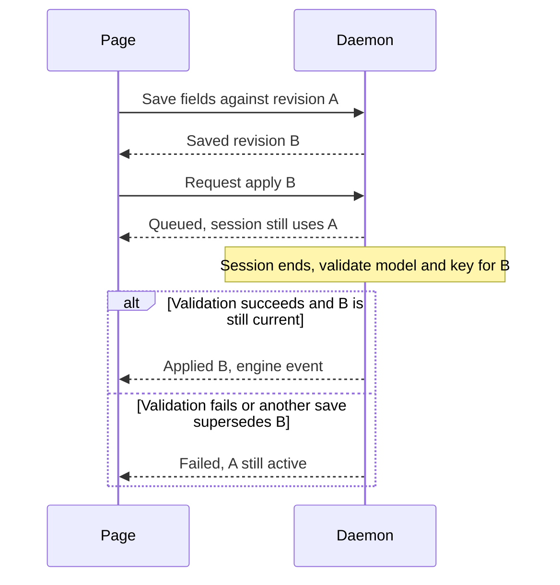

# Voiceless console API

The console is served by `voiceless daemon`, `voiceless web` and
`voiceless history serve`. The default URL is `http://127.0.0.1:8790/`. The page is a
single embedded app built from `frontend/`. Everything below is JSON
over HTTP unless noted.

## Security

- The console listens on loopback only. A configured wildcard resolves to
  the matching loopback address.
- Every request must carry `Host: 127.0.0.1:<port>`, `localhost:<port>` or
  `[::1]:<port>` with the bound port (blocks DNS rebinding). Anything else →
  `421`.
- Every `/api/*` request must carry the session token: header
  `X-Voiceless-Token: <token>`, or `?token=<token>` for `EventSource` and
  `<audio src>` URLs. Missing/wrong → `403`. The token is random per server
  start and is embedded in the served page as
  `<meta name="voiceless-token" content="...">`; cross-site pages cannot
  read it.
- Mutating requests with an `Origin` header must have a loopback origin on
  the same port (`http://127.0.0.1:<port>`, `http://localhost:<port>` or
  `http://[::1]:<port>`) → otherwise `403`.
- Secrets are write-only: config reads return `""` for `api_key`,
  `access_key` (and the `[doubao]`/`[cloud]`/`[processing]` keys) plus a
  boolean `has_<field>`; writing `""` keeps the stored secret, writing
  `null` clears it.

Errors: non-2xx with body `{"error": "message"}`.

## Live session (daemon only; `history serve` answers 503 `{"error":"daemon not running"}`)

| Method | Path | Body / query | Response |
|---|---|---|---|
| GET | `/api/status` | — | `Status` |
| GET | `/api/events?token=` | — | `text/event-stream`, one `data: <json>` per event |
| POST | `/api/session/toggle` | `{"mode": "quick"}` (mode optional, `""` = default) | `{"ok": true, "outcome": "started"}` |
| POST | `/api/session/start` | `{"mode": "..."}` | `{"ok": true, "outcome": "started"}` |
| POST | `/api/session/stop` | — | `{"ok": true, "outcome": "stopping"}` |
| POST | `/api/session/cancel` | — | `{"ok": true, "outcome": "cancelled"}` |
| POST | `/api/session/practice` | `{}` to start, or `{"arm":true}` for a hotkey trial | The practice session's verdict. The final text stays in the practice field. |
| POST | `/api/session/disarm-practice` | — | Clears the pending hotkey trial. |
| POST | `/api/session/narrate` | — | Starts local annotation dictation and returns the session verdict. |
| POST | `/api/engine/reload` | `{"revision":"…"}` or empty for a forced engine reload | `{"ok":true,"config_apply":{…}}` once queued. A stale revision returns 409. |

Successful session commands return a `session_id` that matches `Status`
and events for the session. Cancelling while idle returns `null`. A start
while busy, toggle while stopping or stop while idle returns 409 with the
reason. Toggle reports `started` or `stopping` for the action it took.
Clients can include `runtime_id` on any session command and `session_id` on
stop and cancel. The runtime returns 409 for an expired instance or session.

`Status`:

```json
{
  "daemon": true,
  "state": "idle | recording | stopping",
  "runtime_id": "opaque-instance-id",
  "event_sequence": 42,
  "session_id": null,
  "session": {"id": 3, "phase": "completed", "config_revision": "opaque-config-revision", "transcript": null, "injection": null, "error": null},
  "mode": "quick",
  "default_mode": "quick",
  "backend": "local-offline",
  "fallback_backend": null,
  "engine": {"loaded": true, "description": "qwen3-asr-1.7b-gguf on cuda", "load_seconds": 2.1, "error": null},
  "config_apply": {"active_revision": "opaque-config-revision", "target_revision": null, "state": "idle", "error": null},
  "gpu": [{"name": "NVIDIA GeForce RTX 3070", "memory_used_mib": 4100, "memory_total_mib": 8192}],
  "hotkey": {"key": "KEY_SCROLLLOCK", "keyboards": 2, "error": null},
  "last_session": {"backend": "local-offline", "audio_seconds": 6.1, "stop_to_final_ms": 180, "chars": 32, "ended_at": "2026-10-20T14:05:00Z"} ,
  "uptime_seconds": 3600,
  "version": "0.1.0"
}
```

`gpu` is `[]` without `nvidia-smi`; `last_session` is `null` before the first session.

The `session` field describes the active or most recently ended session.
`session_id` is set only while a session is active.
`session.config_revision` identifies the settings that session started with.
`config_apply` reports `idle`, `queued`, `loading`, `applied` or `failed`.
On failure, `error` describes the operation and `active_revision` is the
revision still used for new sessions.

Every `/api/events` connection starts with a `snapshot` event containing
`status` and `default_mode`. Lagging subscribers receive a new snapshot.
Later events carry `runtime_id` and a monotonically increasing
`event_sequence`. Apply events from the snapshot's instance with greater
sequence numbers. Reconnecting clients obtain the current token from
`/index.html` and resume from a new snapshot.

Daemon events include the same session events as `voiceless stream --json`.
`voiceless ctl watch` receives the live events on D-Bus.

- `{"type":"state","state":"recording","mode":"quick","overlay":null}` includes the active overlay preference. `null` uses the desktop watcher setting.
- `{"type":"ready"}`, `{"type":"transcript","transcript":{"authoritative_text":"…","partial_text":"…","confirmed_segments":[…],"is_final":false}}`
- `{"type":"level","rms":0.12}` — mic level 0..1, ~15 Hz while recording
- `{"type":"finalized","injection":{"ok":true,"method":"fcitx5","message":"","delivery":"committed"}|null}` — `delivery` is `committed` (the input method took the text), `unconfirmed` (keystrokes or a paste were sent), `copied`, or `not-delivered` with the reason in `message`, for example that the focus moved to another window while the user spoke
- `{"type":"warning"|"error","message":"…"}`, `{"type":"cancelled"}`, `{"type":"completed"}`
- `{"type":"session","stop_to_final_ms":180,"audio_seconds":6.1,"chars":32}` — after each completed session
- `{"type":"config-apply","config_apply":{…}}` tracks apply requests. An `engine` event includes the newly active config and engine status after a successful activation.
- `{"type":"log","line":"…"}` — each daemon log line

## Config

| Method | Path | Body | Response |
|---|---|---|---|
| GET | `/api/config` | — | Masked `AppConfig` and its opaque `revision` |
| PUT | `/api/config` | `{"revision":"…","fields":{"local.num_threads":8}}` | `{"ok":true,"revision":"…","restart_engine":true,"config":{…}}` |
| GET | `/api/config/template` | — | `{"toml":"…"}` with credential fields omitted |
| POST | `/api/config/restore` | `{"revision":"…"}` naming the currently saved settings | `{"ok":true,"config_apply":{…}}` when the active revision has been restored to disk. A stale revision returns 409. Requires a daemon. |

An edit carries the revision the user saw and just the fields they changed.
For example, a later thread-count edit merges with an earlier Vulkan device
change. Overlapping edits return 409 with `revision`, `config` and the
conflicting paths in `conflicts`, so the client can review and retry.

The locked writer preserves TOML comments and validates before atomically
replacing the file with mode `0600`. Invalid settings return 400. The older
`PUT` body of `{section: {key: value}}` and `voiceless config patch` on stdin
save through the same writer with last-writer-wins field updates.



`restart_engine` flags changes to `[local]`, decoder hotwords, the realtime
backend, the selected streaming model directory, `[hotkey]` or
`audio.source`. Other settings can take effect before the next session.
The standalone console saves settings for the next daemon launch.

Sections: `asr`, `cloud`, `doubao`, `local`, `text`, `hotkey`, `audio`,
`inject`, `processing`, `history` — same keys as `config.toml` (README
"Configuration").

| Method | Path | Body | Response |
|---|---|---|---|
| POST | `/api/text/preview` | `{"text": "…", "config": <TextConfig>}` (config optional = saved one) | `{"ok": true, "text": "cleaned"}` or 400 for an invalid rule |

## Models

| Method | Path | Response |
|---|---|---|
| GET | `/api/models` | Entries contain `id`, `name`, `version`, `size_bytes`, `license_status`, `kind`, `languages`, `devices`, `imported`, `installed`, `installing`, `progress`, `error` and `in_use`. `devices` lists provider values supported by this build. `progress` is the download ratio while bytes arrive and `null` during verification. |
| POST | `/api/models/{id}/install` | `{"ok": true}` (starts a background install; poll `/api/models`) |
| POST | `/api/models/import` | Send GGUF bytes with `Content-Length` and an optional percent-encoded `X-Voiceless-Filename` basename. Returns `{"ok":true,"id":"imported-…-gguf"}` after verification. Invalid or incomplete requests return 400 or 411, incompatible files return 422, occupied models return 409, and insufficient disk space returns 507. |
| DELETE | `/api/models/{id}` | `{"ok": true}`. Returns 409 while the model is in use or another operation holds it. |

## Modes

| Method | Path | Body | Response |
|---|---|---|---|
| GET | `/api/modes` | — | `[{"id","name","prompt","processing_label","builtin","sort_order"}]` |
| POST | `/api/modes` | `{"name","prompt","processing_label"}` | the new mode |
| PUT | `/api/modes/{id}` | any of `{"name","prompt","processing_label"}` | the updated mode |
| DELETE | `/api/modes/{id}` | — | `{"ok": true}` (builtins refused with 409) |
| POST | `/api/modes/preview` | `text`, optional `mode`, `app_id`, `site`, `project`, draft `output`, `send_model` | `text`, `error`, and `trace` with the selected mode, context source, and before/after text, elapsed time and error per step. Preview captures no audio and creates no history. |
| GET | `/api/prompt` | — | `{"prompt","model","provider"}` (organize prompt; unchanged from the history console) |
| POST | `/api/prompt` | `{"prompt": "…"}` | `{"ok": true}` |

`POST /api/text/preview` accepts `mode` and `project` to preview the merged vocabulary. It returns `recognition_bias` for the configured backend and model. `null` means the imported model's vocabulary support is determined when it loads.

`POST /api/text/vocabulary/merge` accepts `base` and `incoming` vocabulary objects with `hotwords`, `replacements`, and `rules`. It returns proposed `terms` and a `report` with `added`, `duplicates`, and `conflicts`. Save confirmed terms through `/api/config`. This endpoint only previews the merge.

## History

| Method | Path | Query/body | Response |
|---|---|---|---|
| GET | `/api/records` | `limit`, `cursor`, `q`, `from`, `to`, `mode`, `app`, `model`, `audio=with\|without` | `{"records":[HistoryRecord],"next_cursor"}`. Start a new request without a cursor after changing filters. |
| GET | `/api/records/facets` | — | `modes`, `apps`, and `models` grouped by value and record count. |
| GET | `/api/records/export` | Same filters as `/api/records` | `{"csv","exported"}` for the entire filter selection. |
| GET | `/api/totals` | — | `{"records","characters","duration_seconds"}` (unchanged) |
| GET | `/api/audio/{id}?token=` | `Range` supported | `audio/wav` (unchanged) |
| DELETE | `/api/records/{id}` | — | `{"ok": true}` (also removes the recording) |
| POST | `/api/records/{id}/retranscribe` | `{"model":"sense-voice-int8"}` or an empty body for the active local model | `text`, `cleaned`, `seconds`, `engine`, `record` and a pending `revision`. Requires a daemon, the saved recording and the selected local model. |
| GET | `/api/records/{id}/revisions` | — | `{"revisions":[…]}` with the original, proposed and adopted versions. |
| POST | `/api/records/{id}/revisions` | `{"text":"…","expected":"…"}` | `record` and the proposed correction. `expected` is the current final text the user saw. |
| POST | `/api/records/{id}/revisions/{revision}/adopt` | `{"expected":"…"}` | `record` and the adopted `revision`. Use a previous revision to restore it. A conflicting change returns 409. |
| POST | `/api/corrections` | `{"original": "…", "corrected": "…"}` | `{"ok": true, "suggestions": [{"from": "张三峰", "to": "张三丰"}]}`. The selected corrections are merged into the chosen global, mode or project vocabulary. |

`HistoryRecord`: `{"id","created_at","duration_seconds","raw_text","processing_mode","processed_text","final_text","status","character_count","asr_provider","asr_model","audio_path","has_audio","app_id"}`. `app_id` can be absent on earlier records. Date bounds use whole-second RFC 3339. `from` is inclusive and `to` is exclusive. Audio filters use the stored recording reference.

The daemon reuses a compatible warm model or loads the selected model for the recording. A Sherpa-ONNX model uses CPU even when live GGUF dictation uses Vulkan. The pending revision records the model and device. Adoption is a separate request.

| Method | Path | Body | Response |
|---|---|---|---|
| POST | `/api/history/retention/preview` | `text_days`, `audio_days`, `failed_audio_days`, `failed_audio_mb` | Counts for `text`, `audio` and `recovery` with a single-use `snapshot`. A period of zero keeps that category until manual deletion. |
| POST | `/api/history/retention/confirm` | `{"snapshot":"…"}` | `report` after removal, or 409 with a fresh `preview` when the selection changed. |
| POST | `/api/history/export` | `format` (`txt`, `md`, `csv`, `json`), optional `filter` or `ids`, and `include_audio` (default `false`) | A downloadable document, or a ZIP when audio is included. |
| GET | `/api/history/recovery` | — | `recordings` and `can_reopen` for recoverable failed sessions. |
| POST | `/api/history/recovery/{id}/reopen` | — | The `id` of a local transcription job. Requires the daemon's job queue. |

## File transcription

The daemon owns the queue. Upload the original bytes with `Content-Length`. `GET /api/jobs` lists the formats supported on this host, the maximum upload size, jobs and recovery information.

| Method | Path | Request or result |
|---|---|---|
| POST | `/api/jobs` | Supply query parameters `name`, `model`, `transport` and optional `language`. Cloud processing requires `cloud_authorized=true`. Returns `{ "id": "…" }`. |
| GET | `/api/jobs/{id}` | Job details and saved segments. |
| POST | `/api/jobs/{id}/{action}` | `pause`, `resume`, `cancel` or `retry`. An invalid transition returns 409. |
| POST | `/api/jobs/{id}/reselect` | Upload replacement source bytes when the job needs its source again. |
| GET | `/api/jobs/{id}/export/{format}` | `name`, MIME `type` and `text` for `txt`, `json`, `srt` or `vtt`. |
| DELETE | `/api/jobs/{id}` | Removes the job if its current state allows removal. |

## Meetings

`GET /api/meetings` returns the current `runtime_id`. Use it when starting, stopping or recovering a meeting. `GET /api/meetings/sources` lists the microphone and system-output identifiers available on this host.

| Method | Path | Request or result |
|---|---|---|
| POST | `/api/meetings/start` | `runtime_id`, `microphone` and optional `system` output. Returns the meeting with its selected sources. |
| GET | `/api/meetings/{id}` | The meeting, its tracks and recording state. |
| POST | `/api/meetings/{id}/{action}` | Send `runtime_id` with `stop`, `recover`, `retry` or `discard`. |
| GET | `/api/meetings/{id}/review` | Returns the review, tracks, eligible completed jobs, data location and configured summary destination. |
| POST | `/api/meetings/{id}/review` | Send the review `revision` with `action` set to `attach`, `separate`, `edit`, `local` or `remote`. A remote summary requires selected `segments`, explicit `consent` and the matching `destination`. |
| GET | `/api/meetings/{id}/review/audio/{track}` | The finalized audio for the selected track. Supports HTTP range requests. |
| POST | `/api/meetings/{id}/review/export` | `name` and `text` for a JSON export of the saved review. |

## Hotkey & injection

| Method | Path | Body | Response |
|---|---|---|---|
| GET | `/api/hotkey/keys` | — | `[{"code":"ScrollLock","evdev":"KEY_SCROLLLOCK"}, …]` browser `KeyboardEvent.code` → evdev name for the key-capture widget |
| POST | `/api/inject/test` | `{"text": "…", "delay_ms": 3000}` | `{"ok": true, "injection": InjectionResult}` — waits `delay_ms` (user focuses a field), then injects with the configured method |

`GET /api/status` and the `hotkey` event report the active `hotkey.bindings`
with the configuration field, chord and readable keyboard count. The
`hotkey.portal` object carries the system trigger or the registration error.
The active bindings stay in place when saving or applying new ones fails.

## Desktop capabilities

| Method | Path | Response |
|---|---|---|
| GET | `/api/desktop/audio` | `{"microphones":[{"id":"…","label":"…"}],"system_default":null,"selected":null,"effective":null,"error":null}` |
| GET | `/api/desktop/overlay` | `{"available":true,"reason":null}` when the compositor advertises Wayland layer shell |

Set `audio.source` to a microphone `id` or `null` to follow the system
default. `effective` identifies the input linked to the recorder during
a session. When idle, it describes the selected or default device for the
next session. The optional `audio.overlay` field controls an enabled Eww
watcher through the `overlay` field on recording state events.

## Diagnostics

| Method | Path | Response |
|---|---|---|
| GET | `/api/doctor` | `[{"name","present","required","detail"}]` |
| GET | `/api/logs` | `{"lines": ["…"]}` — last 500 daemon log lines (live ones arrive as `log` events) |
| POST | `/api/benchmark` | body `{"limit": 10}` → runs the warm engine over the latest recordings that have audio; `{"ok":true,"engine":"…","results":[{"id","audio_seconds","decode_seconds","rtf","reference","text","cer"}],"mean_rtf","mean_cer"}` (`reference` = the record's `raw_text`, i.e. what produced it originally) |
