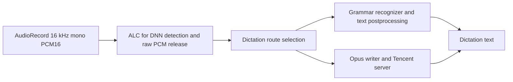

# WeChat Input voice research

## Official distribution

Tencent’s WeChat Input (微信输入法, WeType) publishes separate download channels. Versions in the product changelog and package endpoints can differ. Sizes below are the totals reported by HTTP range responses. A four-byte probe confirmed APK/ZIP or PE file magic for each linked package. The probe checks the response type, while package identity and signatures require full-file evidence. [Product site](https://z.weixin.qq.com/) · [Download configuration](https://z.weixin.qq.com/web/api/app_info) · [Changelog](https://z.weixin.qq.com/web/change-log/)

| Platform and channel | Official acquisition and observed metadata |
| --- | --- |
| Android product site | The mobile download page’s generic Android route redirects to `wxkb_1425_32.apk` under `4.0.2`. The APK response totals 230,610,559 bytes. [Mobile page](https://weread.qq.com/wetype) · [Website redirect](https://z.weixin.qq.com/android/download?channel=website) · [Direct APK](https://download.z.weixin.qq.com/app/android/4.0.2/wxkb_1425_32.apk) |
| Android Tencent App Store | The listing publishes package `com.tencent.wetype`, version 4.0.1, size 230,561,398 bytes and MD5 `0865068a53e47ebb71550a0de94e8b66`. The listing spells the CDN URL with HTTP. The HTTPS equivalent returned APK magic in a range probe, and one full acquisition attempt received a CDN challenge page. [Tencent App Store listing](https://sj.qq.com/appdetail/com.tencent.wetype) · [Direct APK over HTTPS](https://imtt2.dd.qq.com/sjy.00009/sjy.00004/16891/apk/0865068A53E47EBB71550A0DE94E8B66.apk?fsname=com.tencent.wetype_4.0.1.apk) |
| macOS | The public download is a 3,059,360-byte installer ZIP. The production `InstallInfo` manifest points to the 341,548,718-byte app ZIP, version 3.0.2.689, and publishes MD5 `15643be525c1d4ce4e1489a1254ab861`. [Public installer ZIP](https://download.z.weixin.qq.com/app/mac/2bf73634ad8451b0b225bbc25ac1e1eb/WeTypeInstaller.zip) · [Production manifest](https://download.weread.qq.com/app/wxkb/mac/3.0.2/install_info_3.0.2_689.json) · [App ZIP](https://download.weread.qq.com/app/wxkb/mac/3.0.2/WeType_3.0.2_689.zip) |
| Windows | The public `download_link` points to a 2,858,536-byte installer. The same configuration lists a 218,295,656-byte 3.0.2.44 installer under `official_p`. The separate `latest` and `feedback` fields point to 3.0.3.8, while the release log lists 3.0.2 as the public release. [Public installer](https://download.z.weixin.qq.com/app/win/wetype_installer_official_p_67.exe) · [Versioned 3.0.2.44 installer](https://download.z.weixin.qq.com/app/win/WeTypeSetup_3.0.2.44_3.exe) · [3.0.3.8 configuration entry](https://download.z.weixin.qq.com/app/win/WeTypeSetup_3.0.3.8_3.exe) · [3.0.2 release](https://z.weixin.qq.com/web/change-log/185) |

## Speech processing and privacy

- **Online speech-to-text.** The policy effective 2026-09-21 puts voice-to-text in the optional 拼写Plus section. Under §1.4.3, Tencent says the feature requests microphone permission, uploads speech during use for real-time server processing, returns text, and does not store the submitted speech. The summary describes upload as user-triggered. The information-collection list identifies speech data and its speech-to-text purpose. [Privacy policy](https://z.weixin.qq.com/web/privacy) · [Privacy summary §2.2](https://cdn.z.weixin.qq.com/page/article/index/30.html) · [Information-collection list §10](https://cdn.z.weixin.qq.com/page/article/index/27.html)
- **On-device Android speech-to-text.** Tencent explicitly documents recognition without a network in Android 1.2.2 and offline speech in 3.0.0. Android 3.5.4 and 3.5.5 explicitly enable offline speech in standalone mode (`单机模式可用离线语音`). These releases establish an Android on-device path. The sources leave open how the recognizer is provisioned or selected in other modes, which languages and cleanup features work offline, and what happens when a network drops mid-session. [Android 1.2.2](https://z.weixin.qq.com/web/change-log/63) · [3.0.0](https://z.weixin.qq.com/web/change-log/141) · [3.5.4](https://z.weixin.qq.com/web/change-log/172) · [3.5.5](https://z.weixin.qq.com/web/change-log/175)
- **Desktop and AI Recorder scope.** The reviewed macOS and Windows dictation release notes describe live text and cleanup. Desktop offline recognition and the storage and processing behavior of the separately advertised AI Recorder (`AI 录音笔`) remain open. §1.4.3 describes speech-to-text and predates the AI Recorder launch entries. [macOS dictation](https://z.weixin.qq.com/web/change-log/144) · [Windows live dictation](https://z.weixin.qq.com/web/change-log/170) · [Privacy policy](https://z.weixin.qq.com/web/privacy) · [Android AI Recorder](https://z.weixin.qq.com/web/change-log/178) · [macOS AI Recorder](https://z.weixin.qq.com/web/change-log/177) · [Windows AI Recorder](https://z.weixin.qq.com/web/change-log/176)

## Speech milestones relevant to Voiceless

| Platform | Tencent release claims |
| --- | --- |
| Android | 3.0.0 advertises an upgraded speech model, Chinese, English and multiple dialects, and unlimited-duration input. 3.1.0 claims higher accuracy for quiet speech, better noise resistance, and better punctuation. 3.5.0 adds filler removal, punctuation, paragraphing, long-form outline formatting and reordering awkward phrasing. 3.5.4 and 3.5.5 describe smoother voice input. [3.0.0](https://z.weixin.qq.com/web/change-log/141) · [3.1.0](https://z.weixin.qq.com/web/change-log/143) · [3.5.0](https://z.weixin.qq.com/web/change-log/155) · [3.5.4](https://z.weixin.qq.com/web/change-log/172) · [3.5.5](https://z.weixin.qq.com/web/change-log/175) |
| macOS | 2.0.0 describes Fn hold, live insertion, unlimited-duration dictation, and mixed Chinese, English and dialect speech. 2.2.0 adds transcript cleanup. 2.2.3 adds microphone selection and continued dictation across window or input-field switches. [2.0.0](https://z.weixin.qq.com/web/change-log/144) · [2.2.0](https://z.weixin.qq.com/web/change-log/152) · [2.2.3](https://z.weixin.qq.com/web/change-log/168) |
| Windows | 2.1.0 advertises Ctrl+Win hold and transcript cleanup, including condensing repetitions. 2.1.2 adds microphone selection. 2.1.3 adds live insertion into the input field. [2.1.0](https://z.weixin.qq.com/web/change-log/153) · [2.1.2](https://z.weixin.qq.com/web/change-log/166) · [2.1.3](https://z.weixin.qq.com/web/change-log/170) |

The WeChat Input algorithm filing linked by the user agreement documents Hunyuan multimodal generation and AI dialogue. The product’s speech sources leave the ASR model identity, audio frontend, voice activity and endpointing rules, and transport unspecified. The quiet-speech, noise-resistance and responsiveness claims come without distance, accuracy or first-text latency measurements in the cited notes. [User agreement §5.5.5](https://z.weixin.qq.com/web/agreement) · [Algorithm filing](https://cdn.z.weixin.qq.com/page/article/index/36.html) · [Android 3.1.0 release](https://z.weixin.qq.com/web/change-log/143) · [Product speech overview](https://weread.qq.com/wetype)

## Inspected release artifacts

| Artifact | Observed package identity |
| --- | --- |
| Android APK | `com.tencent.wetype` 4.0.2 (`59201`), 230,610,559 bytes, SHA-256 `6fe5b1e6597f6d8b9bf44a82e832b7e5c9c7b293149a991f8445bbd19f7ebce5`. REA decoded the manifest and indexed 13,456 classes. V1 and V2 declare the same signer, and the V2 content digest matches. Manifest Evidence `ev_67c2096af113a2673d034ae6164bb9e87d84677d1f8dc924171fa95c995cabf2`. Signing-record Evidence `ev_27c76f50a93358451469ee56ae0e0c764690e18d7cfb34df42ad81c9d8c4b64c`. [Official APK](https://download.z.weixin.qq.com/app/android/4.0.2/wxkb_1425_32.apk) |
| macOS app ZIP | `com.tencent.inputmethod.wetype` 3.0.2 (`689`), 341,548,718 bytes, SHA-256 `eeaaa2e8ec2b269450f5efdc917ac27666a5f04f569bb63df669e2ac8a5eee36`. MD5 `15643be525c1d4ce4e1489a1254ab861` matches the installer manifest. [Installer manifest](https://download.weread.qq.com/app/wxkb/mac/3.0.2/install_info_3.0.2_689.json) |

### Android dictation

- The keyboard's `ImeVoiceView.s(View)` invokes `voice.k.d5/c5`, then the recorder factory creates 16 kHz mono PCM16 input. `l6.g.H` uses `AudioRecord` with Android source `MIC` in the ordinary case. It can choose other source constants when recording is already active or when a fallback runs. The four DEX string tables have no literal Android `NoiseSuppressor`, `AutomaticGainControl`, `AcousticEchoCanceler`, or `AudioEffect` references. The source-selection code leaves OEM microphone processing unmeasured. Evidence `ev_e6084caa5e4938c784eeee64018fd6bd97c904b1ccbe3f7ebf7de491ab29e1f`, `ev_fbecbc57124e9ee96a27e951d6cfde298d7031be744b169bf2ffb882e93130c5`, `ev_0dc1de36ec0104d73f529c8a3bda41af9cf7d4cf1e43234ce9def693d771af71`.
- Android's `r/f/configure_online` enables `preprocess_alc_enable` and selects a DNN frame classifier at 16 kHz. It configures 40 ms output blocks, a 400 ms onset window with 300 ms confirmation, and 150/480 ms onset/end padding. `speech_noise_thresh` maps to `0.80/0.4/0.3`, and `Sb.c.a` passes the resource to NNVad initialization. Evidence `ev_8074680a35203fc8afd785d8cf95923b7b0d82b232cbe4499cb59e85d85bd360`, `ev_a748b2c6de90d4d733e334c2908dd2e9b718d46d0580a9b84565160a2f9a9be3`.
- `voice.P$d.b()` configures the local VAD and selects offline, online, or a flagged dual path. `voice.P.X1` forwards the PCM released by VAD to the local grammar recognizer or the online audio writer. The writer initializes Opus at 16 kHz and 64 kbps. The recorder has a separate feature path and can occupy the offline recognizer, which has an explicit online-only branch for keyboard dictation in that case. Evidence `ev_82ec9a98d904fa0ece519af958d4d36abc4a8ac0321492772da65da1542b68c3`, `ev_f383d1ba8b3f6ea6f19a2fa9013d3a2048cb22911ec4cadbf262d1951d31665b`, `ev_1ebc264e3efff59cdb21687426f134da830f864c07fc7aa630465cecdc7931ea`, `ev_a040ac5debf2ea99748976e10be8555916f4aee9fcac41d94ff8ae8aaef2df0a`.
- The local recognizer calls `Grammar.init/begin/recognize/getResult/end` and a separate `PostProcess` stage. Package code refers to `ime_asr_decoder_model.zip` and `ime_asr_text_process_model.zip` through its offline resource manager. The APK has the VAD assets and the Android JNI libraries, and the two named model ZIPs are separate from the APK's ZIP member inventory. Evidence `ev_80058c3e07d2ebfaa794ada1ffe236b6feca6e89c90382fa87486fa11294dc3c`, `ev_18878d32cebfd8004352732c58f8cc4b3839fc065dc01da0f104f0b9728da5a1`, `ev_c00d52cb86ffd634ac6bb48b1898075b9e28c347729b3862f33a0dc4f80cb546`.
- The package requests four versioned resources with types `102` (decoder native library), `103` (decoder model), `104` (text-processing native library), and `105` (text-processing model). `rescenter.u$g.invokeSuspend` builds `GetImeDictListConfigReq`. The response supplies `dictItemList` entries, and `rescenter.o.q` consumes their `cdnUrl` values. The resource names and versions are derived from the shipped code, while the current payload bytes and URLs depend on the server response. Evidence `ev_6dc06749af4c4473d53ef1043639ff4aa1c999d7b0ebab975568efe48f60da65`, `ev_d4270411aeb62352ceef5d573b537d321d73433575990b759808b997b2f307a5`, `ev_672eae6d64018b5488d682c943742093b34a1cf349d1d71479905e49b9a4d97c`.
- `voice.P.J1` can continue a session offline after an online error. It passes the current session identifier, base text and buffered unused VAD audio to the offline path. In the dual-route branch it marks the online route failed. This shows how the client can keep the visible text and preserve pending audio when recognition changes route. Evidence `ev_e6fde77855dc0ec515f8ee217c74377ca21f544f186b022f0fbf79d5e527a32f`.
- Offline `offline.g.j` starts periodic recognition after more than 12,288 buffered bytes, equivalent to 384 ms of 16 kHz mono PCM16. Dual-link `P.V1/W1` aligns local PCM frame indexes with online file offsets for result merging. Online `F.k1` handles partial stability and response ordering. The keyboard receives a separate final flush when all voice IDs complete. Evidence `ev_18878d32cebfd8004352732c58f8cc4b3839fc065dc01da0f104f0b9728da5a1`, `ev_dd66f5f68780c795f6a24686c84d127738bb422bf415a9781540206ecb36aaf5`, `ev_5768729041264eb09881bfeccd3bf78b8456823d8c2295d4c6565145cdede9f9`, `ev_903c0d00145eba73abbb67d134603c7c2d81b6762c784fed95ddafa1e6938347`.

The Android VAD library's `WX_ASR_VAD_PreAlc_Process` consumes PCM16. Its fixed-gain branch scales each sample. The one-shot branch computes the mean and standard deviation of absolute subframe peaks and, for low-level audio, derives a bounded gain from the mean plus three standard deviations. The stateful branch buffers incomplete subframes, measures each complete subframe's mean and standard deviation, and smooths the applied gain across samples. It uses the last gain when flushing a remainder. This establishes the software gain-control paths. Effective settings on an Android device and the hardware microphone processing remain unmeasured. Evidence `ev_e93727a3044d55cc79727c81f01011b91dc0b6b532d5c4ce3ac17390f96e490f`, `ev_88ce9d5b3b901ae65e3238a0fd76b765af1a6ba782561a00350befe302847c25`, `ev_213cc91086571343a72967e90e781ee277d0655534a192ca60ce99924d28b0f5`, `ev_807670052bef75fa11649393bc3e93e31dcf81ef0c71a6b9e8e1eeef60f74351`, `ev_4eaa5b7aba1b24719881ce4f31823d8c65da08501469119cd2851f915e43efd5`.

### macOS dictation

`WeType.app/Contents/Resources/vad/` carries the 85,352-byte `model_16k_20210121_iter07.bin`, `CMS_40dim_chi.bin` and an offline configuration. The settings app has both offline and online configurations. Both platforms specify DNN frame classification over 40-dimensional filter-bank features, 40 ms output blocks, and 150/480 ms onset and ending padding. Their 324-byte CMS resource is byte-identical. Android and macOS use different DNN model bytes and detection thresholds. The main macOS executable's WebRTC GMM VAD symbols indicate another supported classifier.

The macOS main app's `NativeVoiceManager.startSession` references the packaged offline VAD configuration. `VoiceEngine::feedPCMData` calls `TROpusTool::Encode` and `processVAD`, which invokes `_WX_ASR_VAD_OfflineProcess`. `sendBuffer` calls `buildVoiceTransRequest` and `submitRequest`; the response path enters `parseVoiceTransResponse`. The `wcwss` library exposes WebSocket transport on both platforms. Evidence `ev_228fe1b8accdd9c56c4c22e7eba09e0d0d463e649fe6738e022a83a7b11f1e84`, `ev_a6466b5ad78dfe0acda3f717878bbbef4e2a1a88399ddd64859502ddd219c64a`.

### Denoiser and model attribution

The Android SILK library and macOS Settings executable contain a native `AudioCoder::DoEncode` → `NsFix_Process` → `WaveNsx_Process` path. The macOS implementation calls spectral flatness, noise estimation and synthesis code. The default dictation route traced above uses Opus, and the inspected code does not connect that route to the SILK denoiser. Android also ships a TensorFlow Lite runtime. A shipped TFLite asset and nearby `EN_LM_TFLITE_MODEL` marker suggest keyboard language modeling [INFERENCE]. The VAD blob goes to the separate native DNN loader. Evidence `ev_6e47f18138a00dd0caafa2e4d5d595e288012fadb54a08930a337892b87b83e2`, `ev_2eef1f5cec20ab1a8f3a3b04d46b8a85651a8d3366e339c069ab6cf9932764f9`, `ev_25fd2d289ced53ede972ad797325d13acad8f4ee8d4719a8759509350e091f7d`, `ev_468b1055c2ade8ed018484d878c579e5894fee47f6e110b696f2201689ba5afd`.

The APK and ZIP were inspected statically. The Android native frontend also ran on replayed PCM in a later experiment. There was no Android device or macOS runtime for a matched online/offline dictation trial. Firmware-dependent microphone gain and server inference remain unobserved.

## Downloaded offline acoustic model

An independently published compatibility project identifies a stable Tencent CDN URL for a July 2026 decoder model resource. The downloaded archive is 102,920,639 bytes, MD5 `28386481eb94ff73b28ee3949c0cf690`, SHA-256 `b3729fbe928b25740cc9cd781537175b1db4a445bd78bf464267c0c4633e0863`. Its declared V1 and V2 signer certificate matches the Android main APK's. JDK `jarsigner` verified the JAR payload signature and reported a self-signed certificate with no trusted chain or timestamp. The currently server-selected bundle for a particular device remains unknown. Evidence `ev_4183f7a6881b38b2fdaea4e54c48fb0f2122f2549462cb81d5e03a44c7366a55`. [Tencent resource](https://download.z.weixin.qq.com/publish_words/v1/ime_asr_decoder_model/20260710220526250_ime_asr_decoder_model.apk) · [Discovery source at tested commit](https://github.com/Enter-tainer/wechat-asr-gpu/blob/c97739b22a69a38c655b9036337c3d6d08f697d2/src/pack.rs)

Its inner `ime_asr_decoder_model.zip` has a 135,646,496-byte `XNET` file with SHA-256 `0674250a848ce3eb91024b3c0a6eda61b91ea45b2c40e4900130995e89cb9033`, a 10,502-entry UTF-8 vocabulary, and `feature.conf` and `sr_online.conf`. The configurations select 40-band 16 kHz filter-bank features, `block_spec = 100:400:100`, a `200:30:100` bypass block configuration, and dynamic quantization. The independently implemented loader checks the `XNET` tensor types and shapes and uses a convolutional frontend, 40-layer Transformer and CTC decoding. This identifies the tested offline acoustic model. The Android text-processing resource and Tencent's online model remain distinct. [Compatible model implementation](https://github.com/Enter-tainer/wechat-asr-gpu/blob/c97739b22a69a38c655b9036337c3d6d08f697d2/src/model.rs)

The CPU-only build of `wechat-asr-gpu` at commit `c97739b22a69a38c655b9036337c3d6d08f697d2` loaded the downloaded weights and transcribed two clean clips and their simulated 5 dB noisy versions. The four clips total 26.9 seconds of audio and took 2.0 seconds to decode in batch. A second run paced the short clip in 32 ms chunks and requested a partial every 160 ms. It returned the first preview at 678 ms on clean input and 1,339 ms on the 5 dB variant, then returned the correct final words on both. These are measurements of the compatible acoustic decoder. Device audio processing, Tencent's online decoder and the separate text-processing model were outside the experiment.

## Released Android frontend on replayed PCM

The Android 4.0.2 APK maps DEX resource IDs `0x7f100008`, `0x7f10001c`, and `0x7f100007` to `r/f/configure_online`, `r/f/model_251222_epoch_2_1317396_0_pt.bin`, and `r/f/cms_40dim_chi.bin`. The DNN artifact is 777,872 bytes and has SHA-256 `e04653d2ff58d525438a8ceb36a1c5d68aa4d58e374520c126427f3a8a1bec73`. The Android package passes all three resources into the native classifier.

QEMU user-mode 11.1.2 with Android 28 Bionic ran the original ARM64 library and those unmodified resources. The probe calls the native functions behind JNI with the same input types. The library loaded a 1,000-input, two-output DNN with five intermediate 128-unit layers. It requested 640-byte input blocks (20 ms) and configured 1,280-byte output blocks (40 ms). A clean 3.884-second clip first released PCM after 340 ms of input and returned exactly the original PCM by final flush. This is the timing of the first frontend output in the input stream. The QEMU process and the probe omit Android capture, Java session policy, and network transport. Native anchors include `ev_b467468fe30a8534eed302e456b4525c1f6f6f0b51c52841a839de2bf4c99b93`, `ev_a24a649f54e7fe03c0d03465d00c4bc05493cd8755cf749fe289daf7d8be760a`, and `ev_db0b1bc09eecc1f3dfc7b46ee8325666e6726043ede5ce1c304b75ff0195ee53`.

Unicorn 2.1.4 separately executed the ALC routines with in-memory allocator, logging, math and memory-copy imports. The independently implemented global estimator and fixed-gain PCM transform matched the shipped routines byte-for-byte on nine fixtures (72,649 input samples per path), including silence, a partial frame, the bypass threshold, an outlier, and full-scale conversion. The whole-input estimator returns unity at a mean frame peak of at least 300 PCM16 units. Below that level it estimates gain from the mean plus three standard deviations, targets 80% of full scale and rounds the resulting gain to an integer before clamping it to 1×–25×. The native streaming ALC also produced identical PCM across five input chunk sizes on a 16,131-sample signal. [Unicorn](https://www.unicorn-engine.org/)

The stream routine at `0x13cc98` takes both outputs of `WX_ASR_VAD_PreAlc_Process`. It buffers the raw PCM for release and feeds the gain-adjusted PCM to the classifier. Enabling or disabling `preprocess_alc_enable` on six utterances with five input conditions changed 21 per-call records on one quiet clip. The returned PCM was byte-identical between settings for all 30 cases. Twenty-nine outputs matched the original input exactly. The other was an unchanged suffix starting 860 ms into the quiet clip. Evidence `ev_719e057e0a28b6fc33914fb113962cfce05644e2bdd76c3993b971359a049d4e`.

The original frontend output fed the independently implemented decoder with Tencent's original acoustic weights. The three paired paths (raw, original frontend with ALC, original frontend without ALC) produced identical final text per clip. Mean CER was 1.76% clean, 0.93% for clean speech attenuated by 36 dB, 30.93% at simulated 0 dB SNR, and 7.90% at 5 dB SNR. The recognizer returned empty text on all six noise-only inputs even though the frontend emitted PCM. The release-timestamp replay of `test-01` gave first text at 704 ms clean, 1,397 ms at 0 dB and 1,520 ms at 5 dB. It replays captured VAD output boundaries and uses the independent decoder's partials. The measurements exclude the native frontend's execution time and Tencent's text postprocessing.

Injecting the isolated native streaming ALC ahead of the Voiceless default local route improved +5 dB CER from 94.70% to 45.40% and kept 0 dB at 100%. Quiet clean CER stayed at 18.71%. The existing GTCRN route is retained based on its 12.07% and 40.33% CER at +5 dB and 0 dB respectively. The Bionic harness, the sample comparison and the 90-row frontend/decoder matrix are in the research directory as `nnvad_bionic_probe.c`, `alc-sample-comparison-final.jsonl`, and `original-vad-asr-paired/pairs.jsonl`.

## Voiceless implementation and measurement

Voiceless uses Sherpa-ONNX GTCRN ahead of Silero VAD, blends 35% of the aligned original PCM back in, and caps adaptive gain at 18 dB. The enhanced route uses a Silero speech threshold of `0.25` and 250 ms speech confirmation. The default route uses `0.5` and 160 ms. The early measurements below used a 20% original-signal mix and `0.40` threshold in the enhanced route. The per-session worker flushes denoiser state before the VAD and keeps the original sample count when padding a partial VAD window. These choices use open models. The installed Tencent weights were used in the separate compatibility experiment. [GTCRN implementation](https://github.com/Xiaobin-Rong/gtcrn) · [Sherpa streaming implementation](https://github.com/k2-fsa/sherpa-onnx/blob/v1.13.3/sherpa-onnx/csrc/online-speech-denoiser-gtcrn-impl.h)

The first preview retries quickly after an empty result. If a later decode repeats the displayed preview or returns empty, the worker tries again after 250 ms or the configured interval if it is shorter. It requires new audio and always waits for at least twice the previous decode time. The coordinator delivers ready ASR work before reading buffered capture bursts and keeps a fixed send deadline for each queued frame. Cancellation discards queued local audio after the active decode returns.

The replay used SenseVoice int8 on CPU and six existing Mandarin TTS clips (`test-01`, `test-04`, `test-05`, `test-06`, `test-07`, `test-11`). It simulated distant speech with 18 dB attenuation, delayed reflections, low-pass filtering, and deterministic colored noise. Each CER is the mean of per-clip content CER values. A missing transcript scores 100%.

| Audio | Original build | Final build with enhancement | Final texts, original → enhanced |
| --- | ---: | ---: | ---: |
| Clean | 0.39% | 0.83% | 6/6 → 6/6 |
| Simulated far, 0 dB SNR | 100% | 40.33% | 0/6 → 6/6 |
| Simulated far, 5 dB SNR | 94.70% | 12.07% | 1/6 → 6/6 |
| Noise only | Unmeasured | No text | Unmeasured → 0/6 |

The final build reproduced these CER values in the 24-trial enhanced replay. All 12 simulated far-field trials produced both live and final text. Five of six clean enhanced trials produced live text during standalone startup, and all six produced final text. The final default and enhanced routes each produced zero live or final text in six noise-only trials. Per-trial results are in `final-default-replay.jsonl` and `final-enhanced-replay.jsonl` in the research directory.

The initial enhancement averaged 48.59% CER at 0 dB and 15.80% at 5 dB. Adding the original signal reduced those values to 42.79% and 12.07%. Lowering the enhanced VAD threshold reduced the clean rate from 2.59% to 0.83% and the 0 dB rate from 42.79% to 40.33%. The switch stays opt-in because some near-field samples lost a word, and the evaluated noise and utterances cover a narrow range. [Replay driver](../scripts/asr_benchmark/replay_local.py)

The default live route confirms speech after 160 ms above the Silero threshold. Shortening the enhanced route to 160 ms kept the clean mean at 0.83% and produced no text on the six noise-only trials. Its CER moved from 40.33% to 45.86% at 0 dB SNR and from 12.07% to 9.83% at 5 dB SNR. The enhanced route keeps the 250 ms setting for the hardest tested input. On clean audio with enhancement disabled, the shorter setting changed one written character across six final transcripts (`洒` to `撒`), raising content CER from 0.39% to 1.22%.

### Warm streaming latency

An isolated, warmed D-Bus daemon replayed the six clean clips with SenseVoice int8 on CPU, paced PCM delivery, and enhancement disabled. Each timing is the median across the six clips. The longest gap across capture includes the time before the first update and after the last update. The longest gap between updates uses consecutive visible transcript events.

| Metric | Original | Earlier onset only after queue changes | Earlier onset and unchanged-preview retry |
| --- | ---: | ---: | ---: |
| Capture to first text | 453 ms | 357 ms | 359 ms |
| Longest gap across capture | 893 ms | 1,036 ms | 783 ms |
| Longest gap between updates | 891 ms | 781 ms | 655 ms |
| Stop to final text | 106 ms | 108 ms | 105 ms |

All three runs used the 500 ms target interval after changed text. A separate 400 ms setting trial did not show a consistent gain. The raw warm run is `warm-streaming-comparison.jsonl` next to `warm_compare.py` in the research directory.

The final CPU test suite passed 161 tests with two opt-in tests ignored. The Qwen3-ASR 0.6B int8 test also passed when run separately with real model files. The CUDA-enabled build passed the GTCRN model check. The physical-microphone and Qwen3-ASR 1.7B CUDA inference paths were outside the replay coverage.

### Qwen3-ASR 1.7B GGUF and fast previews

The Qwen3 family in transcribe.cpp 0.4.0 has no streaming hooks. Voiceless's single-model path decodes the accumulated open segment again for each preview. The optional `[local] fast_preview = true` uses SenseVoice int8 on CPU for those previews. The configured GGUF model still decodes closed segments and produces the final transcript. The preview can differ from the final text and receives no Qwen hotwords or text context.

These private D-Bus daemon runs used the installed Qwen3-ASR 1.7B Q8_0 weights with the strict CPU backend, the same six Mandarin clips, a paced 16 kHz PCM input and a 500 ms target interval. The daemon finished loading and verifying its models before each run. Times and event counts are medians across eligible clips. First text uses only clips with live text. The gap between updates uses only clips with at least two visible events, and the gap across capture includes the start and end of capture.

| Clean replay | Before changes (`822ec416`) | Qwen only after the first iteration | SenseVoice preview prototype | Sequential `fast_preview` |
| --- | ---: | ---: | ---: | ---: |
| Clips with live text | 6/6 | 4/6 | 6/6 | 6/6 |
| Capture to first text | 1,517 ms | 1,736 ms | 357 ms | 356 ms |
| Longest gap across capture | 2,108 ms | 4,071 ms | 785 ms | 787 ms |
| Longest gap between updates | 2,007 ms | 3,537 ms | 655 ms | 655 ms |
| Live updates per clip | 2 | 1 | 8 | 8 |
| Stop to final text | 6,757 ms | 5,052 ms | 4,761 ms | 4,743 ms |
| Final content CER | 0% | 0% | 0% | 0% |

The sequential fast-preview run used the same PCM as the Qwen-only run and returned identical final strings on all six clips. It reproduced the prototype's timing. Its longest pause was 3.80 s on `test-07` while the worker was decoding a closed segment with Qwen.

| Input | Qwen-only CER | GTCRN + sequential fast-preview CER | Clips with final text, Qwen only → combined | Combined capture to first text |
| --- | ---: | ---: | ---: | ---: |
| Simulated far, 0 dB SNR | 100% | 19.87% | 0/6 → 6/6 | 1,097 ms |
| Simulated far, +5 dB SNR | 93.18% | 4.85% | 2/6 → 6/6 | 746 ms |
| Noise only | Unmeasured | — | Unmeasured → 0/6 | No live text |

PCM hashes matched within each paired speech trial. All 12 noisy speech clips in the combined run also produced live text. The paired comparison measures the combined settings. The enhanced Qwen-only condition was not measured. The recordings simulate attenuation, reflections and noise. Real microphone distance, room acoustics, CUDA inference timing, and Tencent's deployed online model remain unverified.

Per-clip files in the research directory include `gguf-prechange-clean.jsonl`, `gguf-current-raw.jsonl`, `gguf-dual-clean.jsonl`, `gguf-fast-preview-final-clean.jsonl` and `gguf-fast-preview-final-noisy.jsonl`. The formal runs used `warm_gguf_replay.py`, with daemon logs under `gguf-replay-logs/`.

One standalone `voiceless --config … stream --json --no-inject` run on `test-01` with both models installed began capture 51.61 s after launch, including model verification in the open path. It emitted one live update 3.59 s after capture began and the same final transcript 3.29 s after capture ended. The warm-daemon first-text figures apply to sessions opened after the engine has loaded. The standalone result is `gguf-fast-preview-final-oneshot.jsonl`.

With only Qwen and Silero available in a private model store, the same CLI path exited with code 1 and named the missing `sense-voice-int8` model and its install command. The event log is `gguf-fast-preview-missing.jsonl`.

### Preview updates during GGUF finalization

With `fast_preview` enabled, the capture worker now sends VAD-closed audio to a separate finalization thread. That thread runs the selected GGUF model in capture order with the same preceding-text context. The capture worker keeps decoding previews as audio arrives. The last preview of a pending segment remains visible until its final result arrives. The confirmation replaces that segment while preserving all later previews in the same transcript snapshot. A normal stop flushes the VAD and waits for each final result. Cancellation discards queued work and allows an in-flight native decode to release its resources.

The sequential comparison used `test-07` and a PCM fixture joining `test-07`, `test-06`, and `test-11` with one second of silence between clips. The last snapshot before the longest in-recording gap was followed by a new segment confirmation in both inputs. The JSONL timeline records visible text and the number of confirmed segments. The clean and noisy corpora are public TTS replay fixtures.

| Clean input | Longest gap between visible updates | Visible updates during capture | Stop to final text |
| --- | ---: | ---: | ---: |
| `test-07`, sequential → concurrent | 3.792 s → 0.716 s | 13 → 18 | 5.954 s → 5.910 s |
| Three joined clips, sequential → concurrent | 6.222 s → 1.307 s | 15 → 38 | 6.374 s → 6.785 s |

The two runs used the same PCM for each input. All seven clean results, including the joined fixture, matched the previous final strings exactly. At live confirmation in both long fixtures, later speech was visible in the same snapshot. Across the six individual clips, median first visible text was 358 ms. Median time to the first preview beginning with the reference's first two content characters was 618 ms. The first visible event can contain an incorrect guess.

The paired timelines are `gguf-preview-sequential-timeline.jsonl` and `gguf-preview-ordered-clean.jsonl` in the research directory. These use the same Qwen3-ASR 1.7B Q8_0 strict CPU backend and SenseVoice preview model as the previous comparison.

All 18 enhanced far-field and noise-only trials returned the same final strings as the sequential build, with identical input PCM hashes. All 12 speech trials showed live text. The six noise-only trials showed neither preview nor final text. Explicit D-Bus stop followed by cancel exited with code 130 and no final event. The next session in the same daemon transcribed the same clip successfully. The CPU suite passed 162 tests with two opt-in tests ignored. The CUDA-enabled build also passed compilation. See `gguf-preview-ordered-enhanced.jsonl` and `gguf-preview-cancel-via-stop.jsonl`.

#### Extra retry after a short first preview

The 35% mix release showed fewer than two alphanumeric characters in the first preview on 19 of 54 speech trials. The next visible update then arrived roughly 520 ms later. Two AVX2 release experiments tried a single extra decode at 160 ms after such a preview, subject to new audio and the existing compute-dependent lower bound. One restarted the regular interval from the early attempt. The other preserved the next regular deadline unless the measured extra decode cost required more time.

Each candidate replayed 74 matching PCM pairs against the 35% mix baseline, including 48 Qwen cases, 24 SenseVoice cases and two clean long-utterance cases. All final strings matched. All 18 noise-only pairs produced no preview or final text. The number of speech trials showing the first two correct normalized characters during capture stayed the same in every group.

| Case | Time to correct opening, median paired change | First-to-second visible update, baseline → candidate |
| --- | ---: | ---: |
| Qwen, 0 dB, shifted interval (9 matching correct openings) | −61 ms | 519 → 452 ms |
| Qwen, 0 dB, preserved deadline (9 matching correct openings) | +1 ms | 519 → 521 ms |
| Qwen, clean short starts, preserved deadline (2 clips) | −616 ms | 519 → 165 ms |
| Qwen, +5 dB short starts, shifted interval (3 matching correct openings) | +162 ms | 523 → 164 ms |

One SenseVoice +5 dB clip showed a correct opening 492 ms later in the preserved-deadline run. Its first nonempty preview medians remained within 16 ms of baseline across groups. The two approaches gave inconsistent gains on the noisy inputs, so the existing scheduler remains in use. See `preview-cadence-short-*.jsonl`, `preview-cadence-preserved-*.jsonl`, `preview-cadence-base-joined.jsonl` and the 35% mix release rows.

#### Shorter interval for all live previews

The same AVX2 release replayed 28 matched inputs with `[local] partial_interval_ms` set to 500 and 300. Each run used a private warmed daemon with GTCRN, SenseVoice previews and Qwen3-ASR 1.7B Q8_0 CPU finalization. The input groups included six individual utterances and a joined three-utterance fixture in each of four acoustic conditions. All PCM hashes and final strings matched, and all seven noise-only cases produced no text at either interval.

| Input | Change in time to correct opening | Change in longest gap between visible updates |
| --- | ---: | ---: |
| Individual clean (6 pairs) | 0 ms | +16 ms |
| Individual at 0 dB (6 pairs) | +64 ms (4 correct-opening pairs) | +60 ms |
| Individual at +5 dB (6 pairs) | −115 ms | +58 ms |
| Joined clean | −2 ms | +69 ms |
| Joined at 0 dB | −71 ms | −221 ms |
| Joined at +5 dB | +1 ms | −316 ms |

Individual values are medians of paired changes. A correct opening requires the first two normalized reference characters during capture. The median first nonempty preview changed by at most 1 ms in each individual group on the same paired basis. The longest clean joined gap overlapped 852 ms of inserted silence at 500 ms and 913 ms at 300 ms. These gaps include silence as well as recognition and scheduling.

The 300 ms run delivered 381 visible updates versus 272 at 500 ms, and 190 versus 125 content revisions that rewrote previous text. Total elapsed time was 274.77 s versus 275.01 s, and measured child CPU time was 677.82 s versus 630.04 s. Both include the harness, capture and daemon. Aggregate process-family memory was not measured. The fixed 300 ms interval cost more CPU and gave mixed gap and correct-opening results, so Voiceless retains 500 ms as the default. See `preview-interval-500.jsonl` and `preview-interval-300.jsonl`.

### Real Mandarin far-field microphone recordings

The AISHELL-4 test subset uses the publisher's 16 kHz, eight-channel PCM16 FLAC recordings and human TextGrids at revision `aada72727856313b19d4a030383c426364931dbf`. I selected the smallest compressed test recording in each room-size group (`L_R004S01C01`, `M_R003S01C01`, `S_R004S03C01`), fetched bytes 0–16,777,215 from each, and decoded the first 131 s of channel 0 with FFmpeg 9.0.2. The replay preserves recorded levels and acoustics. OpenSLR lists CC BY-SA 4.0, the publisher website lists CC BY-NC-SA 4.0, and the publisher's Hugging Face dataset card lists Apache-2.0. The audio and transcriptions used here are retained locally for research. [OpenSLR corpus description](https://www.openslr.org/111/) · [Publisher site](https://www.aishelltech.com/aishell_4) · [Publisher asset tree](https://huggingface.co/datasets/AISHELL/AISHELL-4/tree/aada72727856313b19d4a030383c426364931dbf/test) · [Publisher dataset card](https://huggingface.co/datasets/AISHELL/AISHELL-4/blob/aada72727856313b19d4a030383c426364931dbf/README.md)

Per session, the selection takes the first four nonoverlapping 2–12 s single-speaker annotations with at least six normalized content characters, the first disjoint 12–24 s sequence of adjacent turns by one speaker, and a 2.5 s window from the first sufficiently long gap in annotations. All selected turns end within 130 s. Speech clips include up to 320 ms of original context on each side without extending into another labeled turn. The three room-only windows have no labeled speech. The subset covers four speaker tiers across three sessions. `aishell4/prepare_aishell4.py` and `aishell4/clips.jsonl` in the research directory retain sample offsets, references and SHA-256 digests of the FLAC prefix, TextGrid and exact mono PCM. [TextGrid conventions](https://github.com/lhotse-speech/lhotse/blob/master/lhotse/recipes/aishell4.py)

An independent AliMeeting Eval comparison uses six matched clips from six sessions. The selection takes the earliest single-speaker 2.5–6 s clip with zero labeled overlap in each eligible session of the pinned `eval_n200_headset.jsonl`. It compares microphone-array channel 0 with the corresponding TextGrid-gated headset stem from the same clip. Both derivative WAVs were 8 kHz mono PCM16 and resampled to 16 kHz. For `R8001_M8004_00018730_00022430`, the mirror's array clip had Pearson correlation 0.9973 at zero lag against channel 0 cut directly from Alibaba's official 16 kHz archive. This comparison uses the derivative's transcripts and is limited to the six selected clips. `alimeeting/clips.jsonl` retains exact sample IDs, WAV asset paths and digests. [AliMeeting corpus](https://www.openslr.org/119/) · [Aligned recording method](https://arxiv.org/html/2110.07393v3#S2) · [Pinned mirror manifest](https://huggingface.co/datasets/playwithmino/alimeeting-eval-8k/blob/d42531a5e412332017a96214945a379211a71790/manifests/eval_n200_headset.jsonl)

Both comparisons use the same warmed x86-64-v3 build with SenseVoice previews, the 500 ms preview interval and Qwen3-ASR 1.7B Q8_0 CPU finalization. The enhanced path enables GTCRN, the 35% aligned dry mix, bounded gain and the enhanced Silero settings together. Each input is sent as identical 32 ms PCM chunks over an isolated daemon session. History, cues and text injection are disabled. CER ignores punctuation and whitespace and includes missing final text as deletions. A correct opening requires the first two normalized reference characters in a live preview.

| AISHELL-4 segment group | Clips | Mean CER, enhancement off → on | Pooled CER, off → on |
| --- | ---: | ---: | ---: |
| Individual utterances | 12 | 32.43% → 9.58% | 34.92% → 10.48% |
| Continuous speech | 3 | 52.27% → 6.16% | 50.00% → 6.12% |
| All speech | 15 | 36.40% → 8.90% | 40.70% → 8.81% |

The full set has 511 reference characters. Enhancement reduced edit distance on 13 clips, increased it on one, and tied on one. Live and final text coverage rose from 14/15 to 15/15. Correct live openings rose from 5/15 to 9/15. Across the 14 matched clips with live and final text under both settings, median paired first preview arrived 687 ms earlier, the longest inter-update gap fell by 167 ms, and final text arrived 1,089 ms later after capture. The unenhanced path detected less speech, which reduces its final-decode workload. Among the three room-only clips, one enhanced run emitted a single tentative `嗯` before clearing the preview and returned an empty final. Both settings produced zero final text on all three controls.

The AISHELL-4 replay took 167.08 s without enhancement and 190.67 s with it. Child CPU time was 358.67 s and 531.22 s respectively, including capture, model loading and recognition. Aggregate peak process-family memory was outside the measurement. See `aishell4/raw.jsonl`, `aishell4/gtcrn.jsonl` and the two daemon logs.

| AliMeeting recording path | Clips | Mean CER, enhancement off → on | Pooled CER, off → on |
| --- | ---: | ---: | ---: |
| Array channel 0 | 6 | 99.07% → 8.05% | 98.95% → 8.42% |
| Matched headset | 6 | 9.33% → 4.90% | 8.42% → 5.26% |

Each row contains the same 95 reference characters. Five array clips returned empty finals without enhancement. Every enhanced array clip produced live and final text, with a median first preview of 518 ms from the cut start. Four had a correct live opening. On the headset clips, enhancement added 84 ms to first preview and 120 ms to stop-to-final time, using medians of the paired changes. AliMeeting replay elapsed time was 57.27 s without enhancement and 66.69 s with it. Child CPU time was 102.12 s and 181.85 s respectively. See `alimeeting/raw.jsonl`, `alimeeting/gtcrn.jsonl` and the two daemon logs.

The separate native Silero probe measured 72.51 s of detected speech without enhancement and 123.04 s with it on the 15 AISHELL-4 speech clips. The enhanced pipeline recovers audio that the configured decoder must also process. In `L_R004S01C01-06`, the enhanced threshold `0.25` detected an interval from 166 to 1,676 ms inside the 2.5 s unlabeled gap. Raising the threshold to `0.28`, `0.30` or `0.35` still detected it. At `0.28`, the six AliMeeting array samples lost another 1.73 s of retained audio in aggregate. This probe measures detector boundaries. The threshold alternatives were not tested with full ASR. See `aishell4/native-vad.jsonl` and `real_far_vad_probe.py`.

Keep the current `[local] denoise = true` opt-in path at a 35% mix and the current enhanced VAD settings. The paired recordings establish a large benefit for these real far-field inputs. The headset results, compute cost and one tentative misfire support keeping the opt-in choice. These clips come from public meetings and intentionally exclude annotated overlapping speech. They do not measure the user's own mic and room or the stock WeChat keyboard on the same recordings.

The x86-64-v3 release runs use `warm_gguf_replay.py` with `--fast-preview --pcm-manifest <subset>/clips.jsonl`, with and without `--denoise`, inside `VOICE_PRIVATE_BUS=1 dbus-run-session`. The `aishell4/clips.jsonl` SHA-256 is `01774bc82af1adf5e8fd5c094f284f2f30e2b2f8ea5445f758455aaa8e03301d`. The `alimeeting/clips.jsonl` SHA-256 is `e6e120c8f0dc094dad9fdaa136582e959b4c5d44abda4f01bd5689c115b4ceb1`.

### Far-field onset clipping

A native Sherpa-ONNX replay probe loaded the same GTCRN and Silero models and recorded the VAD input and returned segment bounds on the same 24 PCM fixtures. With the previous enhanced threshold of 0.40 and 250 ms speech confirmation, `test-04` began at 134 ms on clean input, 774 ms at +5 dB SNR, and 2,438 ms at 0 dB SNR. At 0 dB, `test-05` and `test-07` began at 646 ms versus 102 ms on clean input. Shortening onset confirmation from 250 to 160 ms moved the returned segment start by only 6 ms on those three clips. [Sherpa VAD segment boundaries](https://github.com/k2-fsa/sherpa-onnx/blob/v1.13.3/sherpa-onnx/csrc/voice-activity-detector.cc)

The actual Qwen3-ASR 1.7B Q8_0 model decoded three slices of each of six selected noisy clips with prefix errors. All three cuts use the same enhanced PCM16 waveform and end position. Across these six cases, mean content CER was 22.97% at the VAD start, 8.72% with up to 640 ms of earlier audio, and 1.61% from the beginning of the clip. On `test-04` at 0 dB, 640 ms of lookback left CER at 50.00%. The full prefix reduced it to 5.00%. This batch experiment quantifies audio lost before recognition. The selected clips and offline decode do not establish the best lookback for a live microphone or natural background speech. Raw results are `far-field-vad-onset.jsonl` and `far-onset-counterfactual.jsonl`.

On the six remaining test utterances, a fixed 640 ms lookback moved mean CER from 14.52% to 14.23% at 0 dB and from 3.63% to 8.69% at +5 dB. CPU decode time increased from 5.31 s to 5.71 s at 0 dB and from 5.58 s to 5.71 s at +5 dB, measured as medians. All four clean clips with a single detected segment stayed at 0% CER. Two differently segmented clean clips were excluded from the slice comparison. Fixed lookback remains an experiment because of the held-out +5 dB regression. See `far-onset-holdout-counterfactual.jsonl`.

### Enhanced VAD threshold sweep

The native probe compared thresholds from 0.40 to 0.20 with GTCRN, 250 ms speech confirmation and 500 ms end silence. On 12 Mandarin test utterances at 0 dB SNR, 0.25 moved the median speech-detection time from 656 ms to 512 ms without changing segment counts. The same comparison moved detection from 480 ms to 464 ms at +5 dB and from 480 ms to 448 ms on clean input. The 0 dB `test-04` segment start moved from 2,438 ms to 806 ms.

A second probe generated 24 examples each of colored noise, fan-like noise, keyboard-like impulses, and wideband noise. Both 0.40 and 0.25 had zero detections across the 96 noise-only cases. At 0.20, five fan-like cases triggered speech detection. A one-second noise lead-in on each of 48 additional speech fixtures produced no early detections at 0.25. The fan and keyboard signals are synthetic. See `voiceless-vad-threshold-sweep.jsonl` and `voiceless-vad-threshold-stress.jsonl`.

The end-to-end comparison uses a private warmed daemon, paced 16 kHz mono PCM, Qwen3-ASR 1.7B Q8_0 on CPU for final text, and SenseVoice int8 for previews. Both builds use GTCRN and a 500 ms target preview interval. The changed parameter is the Silero threshold on enhanced audio. The comparison checks input SHA-256 for every pair. First preview counts any nonempty text during capture. The correct-prefix metric counts the trials that displayed the reference's first two normalized characters before capture ended.

| Input | Pairs | Mean final content CER | Median first preview | Median longest gap between previews | Median stop to final | Correct opening appeared live |
| --- | ---: | ---: | ---: | ---: | ---: | ---: |
| Clean with enhancement | 6 | 4.02% → 4.02% | 491 → 488 ms | 772 → 628 ms | 5.64 → 5.02 s | 6 → 6 |
| Simulated far, 0 dB SNR | 12 | 17.53% → 12.56% | 943 → 535 ms | 656 → 540 ms | 5.23 → 5.08 s | 6 → 7 |
| Simulated far, +5 dB SNR | 12 | 4.24% → 4.01% | 652 → 588 ms | 536 → 779 ms | 5.40 → 5.30 s | 9 → 10 |
| Noise only | 12 | No text in either run | — | — | — | — |

All 42 input hashes matched. All 30 speech trials produced preview and final text in both runs. All six clean final strings matched. The six clips outside the original prefix-error investigation moved from 15.19% to 16.61% CER at 0 dB and from 3.63% to 4.69% at +5 dB. Most of the aggregate improvement came from the other six clips. At 0 dB `test-04` preserved more of the opening and went from 50% to 35% CER. The mixed-language `test-10` at 0 dB went from 0% to 20%, and `test-09` at +5 dB went from 13.79% to 24.14%. For 0 dB clips that displayed a correct opening, median time to that opening moved from 1.79 s to 2.10 s as coverage grew from six to seven clips. Real room acoustics and CUDA inference timing remain unmeasured.

The 0.25 threshold applies when `[local] denoise` enables GTCRN. The paired JSONL files are `voiceless-vad040-holdout.jsonl`, `gguf-preview-ordered-enhanced.jsonl`, `voiceless-vad025-holdout.jsonl` and `voiceless-vad025-original.jsonl`.

#### Speech confirmation with the 35% mix

The native probe held the 35% mix and 0.25 Silero threshold fixed while varying minimum speech confirmation. Across 24 development utterances and 12 test utterances in clean, 0 dB and +5 dB conditions, the median paired onset moved up by 64 ms at 192 ms confirmation, 96 ms at 160 ms, and 128 ms at 128 ms. Speech-segment counts stayed the same. At 160 ms, test-segment starts moved 6 ms earlier and endpoints stayed fixed. Two 0 dB development clips began more than 350 ms earlier.

None of the 36 corpus noise-only clips or 54 synthetic fan, keyboard and wideband clips triggered speech at any of the four settings. On 18 additional clips containing short synthetic tones, 250 ms detected speech in 14 clips, and each shorter setting detected speech in 16. Six tone clips produced more detected segments at the shorter settings. This probe measures VAD decisions. The daemon replay measures which decisions result in visible text. See `voiceless-confirm-dev.jsonl`, `voiceless-confirm-test.jsonl` and `voiceless-confirm-stress.jsonl`.

The 160 ms release replay matched input hashes across 90 pairs, including 48 Qwen GGUF trials with SenseVoice preview, 24 SenseVoice-only trials and 18 tone-only trials with the combined route. The releases used CPU inference with the same models and paced 16 kHz input. Plain noise produced neither preview nor final text in all 18 pairs. The synthetic tones produced no final text, but visible live guesses increased from 14/18 to 16/18.

| Model and input | Median first preview, 250 → 160 ms | Mean final CER, 250 → 160 ms |
| --- | ---: | ---: |
| Qwen GGUF, clean | 471 → 374 ms | 2.01% → 2.01% |
| Qwen GGUF, 0 dB | 504 → 440 ms | 4.85% → 7.34% |
| Qwen GGUF, +5 dB | 537 → 456 ms | 1.15% → 2.34% |
| SenseVoice, clean | 486 → 390 ms | 3.22% → 3.22% |
| SenseVoice, 0 dB | 535 → 456 ms | 39.12% → 34.49% |
| SenseVoice, +5 dB | 617 → 505 ms | 16.10% → 13.32% |

All 12 clean Qwen final strings matched. The earlier onset improved the SenseVoice-only aggregate and worsened Qwen's noisy final transcripts. The enhanced path retains 250 ms. See `confirm-release-250-tone.jsonl`, `confirm-release-160-tone.jsonl`, `confirm-release-160-qwen.jsonl`, `confirm-release-160-sensevoice.jsonl` and the 35% mix baselines.

### GTCRN original-signal mix

A native screening run rebuilt enhanced PCM with four original-signal fractions. All variants used the same GTCRN model, bounded gain, Silero 0.25 threshold and CPU Qwen3-ASR 1.7B Q8_0 decoder. The screening probe decoded VAD segments independently in float PCM. The Voiceless daemon supplies its preceding-text context across segments and measures events against paced capture.

| Original signal fraction | Development CER at 0 dB | Development CER at +5 dB | Median speech detection at 0 dB |
| --- | ---: | ---: | ---: |
| 0% | 20.14% | 5.26% | 496 ms |
| 10% | 14.33% | 3.48% | 464 ms |
| 20% | 13.69% | 3.12% | 352 ms |
| 35% | 14.07% | 2.95% | 496 ms |

The development set contains 24 utterances per noise level. The test set contains 12 separate utterances. The 35% candidate moved test CER from 12.56% to 4.85% at 0 dB and from 4.01% to 1.15% at +5 dB. Clean CER was 2.30% for both fractions. At 0 dB, median test speech detection moved from 512 ms to 400 ms, and correct opening text rose from eight to ten utterances. One 0 dB test clip regressed from 0% to 8.33% CER. None of the four fractions detected speech in the development set's 24 noise-only clips or in 36 additional synthetic fan, impulse and wideband noise clips. The screened conditions use simulated noise and reverberation. Inputs and results are recorded in `voiceless-mix-dev.jsonl`, `voiceless-mix-test.jsonl` and `voiceless-mix-noise-stress.jsonl`.

Two warmed Voiceless AVX2 CPU releases compared 20% and 35% with paced audio. The tests covered all 12 Qwen GGUF utterances, using SenseVoice previews, and six utterances with SenseVoice as the sole model. All 72 pairs had matching capture PCM digests. Both versions emitted preview and final text on all 54 speech pairs, and no text on all 18 noise-only pairs.

| Model and input | Mean final CER, 20% → 35% | Median first preview | Median stop to final |
| --- | ---: | ---: | ---: |
| Qwen GGUF, clean | 2.01% → 2.01% | 472 → 471 ms | 1,937 → 1,906 ms |
| Qwen GGUF, 0 dB | 10.90% → 4.85% | 535 → 504 ms | 1,915 → 1,965 ms |
| Qwen GGUF, +5 dB | 4.01% → 1.15% | 568 → 537 ms | 2,021 → 2,107 ms |
| SenseVoice, clean | 3.80% → 3.22% | 488 → 486 ms | 96 → 108 ms |
| SenseVoice, 0 dB | 42.37% → 39.12% | 862 → 535 ms | 94 → 100 ms |
| SenseVoice, +5 dB | 18.60% → 16.10% | 665 → 617 ms | 95 → 102 ms |

All 12 clean Qwen strings matched exactly. At 0 dB, correct opening text appeared in live Qwen previews on seven clips at 20% and nine at 35%. SenseVoice's median longest interval between previews at 0 dB increased from 529 to 652 ms. Individual errors remain. The 0 dB Qwen `test-01` worsened from 0% to 8.33% CER and the 0 dB SenseVoice `test-05` from 27.78% to 44.44%. The enhanced route adopts 35% based on the measured aggregate test-set improvement and retains the existing `[local] denoise` switch.

The release rows are `qwen-release-avx2-serial.jsonl` and the four `voiceless-mix-release-*.jsonl` files. The candidate package passed 162 Rust tests with two opt-in tests ignored. Real microphones and GPU inference were outside the replay.

### CPU GGUF finalization

The earlier 16.79 s stop-to-final observation on clean `test-10` was not reproduced when replaying the same clip with the current 0.25 enhanced VAD threshold. Clean, 0 dB and +5 dB runs of the mixed-language clip took 6.11 s, 6.30 s and 6.08 s respectively after capture. The native clean run spent 1.95 s in the encoder, 2.29 s in decoder prompt processing and 1.81 s producing 21 output steps. See `gguf-replay-logs/qwen-native-tail.daemon.log`.

A direct probe compared the generic CPU kernels and AVX2/FMA kernels from transcribe.cpp 0.4.0 on four identical 16 kHz float PCM segments with the same Qwen3-ASR 1.7B Q8_0 weights on a Ryzen 5 5600. Native decode wall time moved from a median of 5.18 s to 1.86 s. Three strings matched exactly. The fourth, a mixed-language clip at 0 dB, matched the reference under the generic engine and mistranscribed `JSON 格式` under AVX2. The generic thread sweep returned identical text at four, six and eight threads. The default eight-thread median was 5.18 s, versus 5.12 s at six and 6.68 s at four. No thread override was shipped.

The optional `voiceless-cpu-avx2` Nix package uses the CPU GGUF engine on x86-64-v3 machines. Its Rust test suite passed 162 tests with two opt-in model tests ignored. During an attempted full replay that overlapped a separate Nix build, one AVX2 session hit the final-event timeout. Its native decoder took 20.25 s, with 16.47 s spent producing 21 tokens. Those timings are excluded from the sequential release comparison.

Two CPU-only release packages built the same Rust sources with the same dependencies. The comparison override disabled the AVX2 package's x86 SIMD flags. Each package replayed six utterances across clean, 0 dB, +5 dB and noise-only conditions through its daemon, with GTCRN and SenseVoice previews. All 24 pairs had matching PCM SHA-256. Sessions ran sequentially after both builds ended.

| Input | Pairs | Median stop to final | Mean final content CER |
| --- | ---: | ---: | ---: |
| Clean | 6 | 5.26 → 2.05 s | 4.02% → 4.02% |
| Simulated far, 0 dB SNR | 6 | 5.48 → 2.08 s | 14.35% → 11.02% |
| Simulated far, +5 dB SNR | 6 | 5.52 → 2.10 s | 7.36% → 7.36% |
| Noise only | 6 | No visible transcript | No text in either run |

Across all 18 speech pairs, the median stop-to-final interval dropped from 5.52 s to 2.09 s and the maximum dropped from 9.32 s to 3.43 s. First preview medians were 489 ms and 487 ms. Seventeen final strings matched exactly. For `test-10` at 0 dB, which had already shown sensitivity to the execution path in the direct probe, the AVX2 release returned the reference content and the generic release mistranscribed `JSON 格式`. This sample demonstrates output variation across the builds and replay paths.

The 24-trial harness used 257.37 s versus 195.21 s of wall time and 924.50 s versus 401.60 s of child CPU time (user plus system). Both include paced capture, model loading, and client startup. The largest individual child RSS was about 3.80 GiB on both runs. Aggregate peak process-family RSS was not measured. Model-ready time from daemon startup was 4.9 s versus 4.2 s. The output files are `qwen-release-generic-serial.jsonl` and `qwen-release-avx2-serial.jsonl`, with per-stage daemon logs under `gguf-replay-logs/`.

#### Qwen final model size on real recordings

An isolated replay compared Qwen3-ASR 1.7B and 0.6B Q8_0 on the same 30 pinned AISHELL-4 and AliMeeting PCM slices described above. Both used the x86-64-v3 release on Ryzen 5 5600, strict CPU inference, GTCRN, SenseVoice previews and the 500 ms preview interval. The managed model checker verified both files. The 1.7B arm repeated all 30 final strings from the earlier enhancement-enabled runs. Both models completed all 27 speech clips. Each emitted one tentative preview across three unlabeled room-only clips, and each returned empty final text for all three.

| Speech group | Pairs | Mean CER, 1.7B → 0.6B | Median stop to final, 1.7B → 0.6B |
| --- | ---: | ---: | ---: |
| AISHELL-4 | 15 | 8.90% → 15.24% | 2.552 s → 1.261 s |
| AISHELL-4 continuous subset | 3 | 6.16% → 9.29% | 4.980 s → 2.433 s |
| AliMeeting array | 6 | 8.05% → 20.98% | 1.403 s → 0.566 s |
| AliMeeting headset | 6 | 4.90% → 6.09% | 1.541 s → 0.660 s |
| All speech | 27 | 7.82% → 14.48% | 1.767 s → 0.743 s |

The 0.6B model reached final text sooner on 25 of 27 speech clips, with a median paired reduction of 994 ms. The maximum observed stop-to-final interval fell from 5.016 s to 2.596 s. Median paired first-preview time changed by +1 ms, and the longest live gap changed by −1 ms. The edit count increased from 58 to 88 over 701 reference characters, a pooled CER increase from 8.27% to 12.55%. Three utterances had fewer edits, 11 tied and 13 had more.

The 1.7B and 0.6B model files are 2,185,030,624 and 850,423,456 bytes respectively. The warmed-engine readiness message reported 4.2 s and 2.3 s from startup. Total replay elapsed time was 251.60 s and 219.76 s. Child CPU time was 689.37 s and 400.18 s. These process-family CPU totals include capture, warm-up and recognition. Comparable process-family peak memory was not measured. See `qwen-model-ab/1.7b.jsonl`, `qwen-model-ab/0.6b.jsonl` and `gguf-replay-logs/real-far-qwen-*.daemon.log`. The combined PCM manifest SHA-256 is `9c44118a191d0500eeb46afae2c753f428ad72ce4b9ac2509ac8990160bae79a`.

The `qwen3-asr-0.6b-int8` ONNX arm replayed the same 30 inputs on CPU in the same release. It used GTCRN and the same target preview interval. The ONNX path decodes its own previews, uses the standard four Sherpa-ONNX threads and defaults to a 15 s segment limit. This is a comparison of complete runtime paths. Mean CER was 12.64% across 27 speech clips, including 14.75% on AISHELL-4, 15.90% on AliMeeting array and 4.13% on matched headsets. The overall medians were 971 ms to first preview, 1.123 s for the longest inter-update gap, and 1.042 s from stop to final. All speech clips returned live and final text. The three unlabeled room clips returned neither. Engine readiness took 3.3 s. Replay used 224.56 s elapsed and 518.40 s of child CPU time. See `qwen-model-ab/0.6b-onnx.jsonl` and `gguf-replay-logs/real-far-qwen-onnx.daemon.log`.

The documented CPU option is `qwen3-asr-0.6b-gguf` with `[local] provider = "cpu"` on the GGUF-enabled AVX2 package. Keep the 1.7B default for recognition accuracy. The smaller GGUF is useful when finalization latency matters more and the user's audio tolerates its greater error rate.

#### SenseVoice previews with Qwen ONNX

The existing `[local] fast_preview` setting now also selects SenseVoice previews for `qwen3-asr-0.6b-int8`. The standard `voiceless-cpu` package uses the same ordered finalizer already used by the two-model GGUF path. Qwen ONNX receives the same VAD-closed segments whether previews are enabled or disabled. The setting remains optional and needs the installed `sense-voice-int8` model. Both the warm daemon and stand-alone `stream` use the same catalog selection. A cold stream with missing SenseVoice returned exit 1 and named the missing model. After exposing the model in the private store, the same input completed with the previous authoritative text.

The two arms of the warmed standard CPU package replayed all 30 pinned real recordings with GTCRN, four Sherpa-ONNX threads and the same 500 ms target interval. The only configuration difference was `fast_preview`. The resulting 27 speech transcripts matched exactly and had mean CER of 12.64%. Three unlabeled room clips had empty finals in both arms. One dual-model preview displayed a tentative `嗯` in the same clip seen with the GGUF/SenseVoice combination.

| Metric across 27 speech clips | Qwen ONNX preview | SenseVoice preview | Median paired change |
| --- | ---: | ---: | ---: |
| First visible text | 979 ms | 570 ms | −289 ms |
| Longest gap between visible updates | 1,386 ms | 783 ms | −430 ms |
| Stop to final | 1,028 ms | 760 ms | −153 ms |

In the three continuous-speech clips, the median longest inter-update gap fell from 3,303 to 848 ms. The first two normalized reference characters appeared live in 16/27 and 14/27 speech clips respectively. Among the 13 clips that met this criterion in both arms, the median paired gain was 261 ms. Live previews can trade correct openings for earlier tentative text.

Elapsed replay time was 226.81 s and 220.20 s. Child CPU time including warm-up and capture fell from 527.42 s to 275.69 s. Logged engine readiness rose from 3.5 s to 4.4 s because the daemon loads both models. Process-family peak memory was outside the measurement. The standard CPU build passed 163 tests with two opt-in model tests ignored. An independent explicit stop-then-cancel probe returned 130 and no final text. The next capture in that daemon completed with the exact same final text as its initial capture.

See `onnx-fast-preview/single.jsonl`, `dual.jsonl`, `cancel.jsonl`, `cold-after.jsonl` and the `onnx-standard-*.daemon.log` files under `gguf-replay-logs/`. `onnx-fast-preview/run_standard_preview_ab.py` runs both arms against the combined PCM manifest in `qwen-model-ab/clips.jsonl`.

#### Paraformer incremental speech and short final chunks

The standard CPU package's `local-streaming` backend fed the pinned `streaming-paraformer-bilingual-zh-en` model 32 ms PCM chunks. Each session loaded the model before capture, while the SenseVoice + Qwen ONNX comparison used a warmed daemon. The timing columns below begin at capture. The pre-enhanced arm rendered GTCRN, the 35% aligned dry mix, and bounded gain offline before replay. This arm tests the recognizer on processed audio. Voiceless currently applies GTCRN at runtime on `local-offline`.

| Path on the same 27 utterances | Mean CER | Median first visible text | Median longest in-recording update gap |
| --- | ---: | ---: | ---: |
| Paraformer, original PCM | 22.30% | 692 ms | 611 ms |
| Paraformer, pre-enhanced PCM | 24.14% | 701 ms | 612 ms |
| SenseVoice previews + Qwen ONNX final, GTCRN | 12.64% | 570 ms | 783 ms |

Paraformer gave a correct two-character opening on 21/27 raw clips, versus 14/27 with SenseVoice, but its median first visible text arrived later. On the three continuous clips its median longest gap was 1.217 s, compared with 0.848 s for SenseVoice. Neither Paraformer arm emitted text on the unlabeled room clips. The current evidence favors retaining the two-model preview path. `paraformer-replay/raw.jsonl` and `enhanced.jsonl` preserve source and replay PCM digests and event timelines.

The existing end-of-input path finalized the feature extractor while the Paraformer recognizer still required a full chunk. Sherpa-ONNX 1.13.3 admits the remaining short chunk when `is_final` is set. Voiceless sets this option on the existing finalization path and lets Sherpa pad the remaining features internally. In the same-library native comparison, it reduced mean CER from 22.30% to 16.90% across the 27 raw speech clips. Sixteen clips had fewer edit operations and 11 tied. All three room clips stayed empty. The native baseline reproduced the original CLI's normalized output on all 30 recordings. Appending 300 ms of silence alone reached 19.21% CER and missed both targeted sentence endings. [Sherpa-ONNX final-chunk implementation](https://github.com/k2-fsa/sherpa-onnx/blob/v1.13.3/sherpa-onnx/csrc/online-recognizer-paraformer-impl.h#L168-L177)

Three files were replayed through the patched `voiceless stream --json --no-inject` with paced capture. `R8003_M8001_00641800_00645090-headset` regained `适合` after `最`, and `R8008_M8013_00653420_00657120-headset` regained `个` after `五`. The third sample matched its previous final output. The three finalizations completed in 58–64 ms after capture on the development build. See `paraformer-replay/short-tail-probe.tsv`, `native-tail-ab.tsv`, `tail-samples.jsonl` and `run_paraformer.py`.

#### Paraformer model reuse between recordings

The `local-streaming` daemon now loads the Paraformer recognizer at startup or engine reload. Each recording creates a fresh Sherpa stream and transcript state. A session with a different model-path override still loads that selection on demand. The managed path verifies the package at load, while explicit directories retain their existing file checks. The console still reserves file re-transcription and replay benchmarks for a loaded `local-offline` engine.

Two consecutive development builds with the same final-chunk fix and the same explicit, verified model directory ran four delegated sessions each on a private D-Bus without portal activation. The sequence was two distinct speech clips, a room-only clip and the first speech clip again. Request-to-capture times were 1,009, 829, 824 and 870 ms before reuse, then 84, 84, 88 and 83 ms. The median fell from 850 to 84 ms. The first-text median after capture was 693 and 694 ms. The patched daemon logged one model load of 0.9 s at startup. All paired PCM hashes and final strings matched. The room-only session showed no text, and the repeat produced the same final as its first run.

The timings use a paced `pw-record` replacement with audio injection and history disabled. They measure the CLI request through capture startup, including D-Bus relay overhead. They do not measure desktop hotkeys or device power-up. A debug-mode managed baseline stalled during the per-session check of the approximately 1 GB model. It was excluded from the latency comparison. See `paraformer-replay/warm-explicit-before.jsonl`, `warm-explicit-after.jsonl`, and `daemon_start_probe.py`.

The patched development build also verified and loaded the catalog model in a private XDG store. The one-time startup took 25.2 s in that build, and the first recording then began capture in 84 ms and matched the explicit-path final. A release-build catalog startup measurement is still unavailable. Seventeen targeted console, daemon and local-streaming tests passed. See `paraformer-replay/warm-managed-after.jsonl` and the matching daemon log.

#### Local finalization past the stop deadline

The local offline coordinator used the same 20 s deadline for capture drain, queuing `finish`, and receiving decoded text. An isolated replay of `test-01` paused the private daemon for 21 s after the final PCM chunk and resumed it. The pre-fix release returned `final event timed out` with exit code 1 and no final transcript. The fixed release received `你好，世界！欢迎使用语音输入。` at 22.45 s after capture with 0% content CER. Both runs used the same 16 kHz PCM and warmed Qwen3-ASR 1.7B Q8_0 on the AVX2 CPU backend with SenseVoice previews.

After the local finish request is queued, the coordinator now waits for a final event, worker error or channel closure. The original cancellation behavior remains available during this wait. A separate stop-then-cancel returned 130 with no final event, and the next session on the same daemon produced the identical expected text. Capture drain and finish submission retain their deadline, and cloud final reception keeps the original shared limit. The release passed 163 tests, with two opt-in model tests ignored. This is a controlled scheduling-delay probe. See `local-final-delay-before.jsonl` and `local-final-delay-after.jsonl`.

### Standard CPU trial package

The standard `.#voiceless-cpu` trial build included the Paraformer model reuse and final-chunk fixes. Its release check passed 163 tests, with two opt-in model tests skipped by the sandbox. The public executable reported `voiceless 0.1.0`. The package uses the standard CPU stack for ONNX and Paraformer.

In a private D-Bus session with paced PCM, Qwen 0.6B INT8 with GTCRN and SenseVoice reproduced the three pinned baseline finals exactly. The two AliMeeting array clips showed first text at 441 and 442 ms after capture, then finalized 386 and 635 ms after stop. The room-only clip briefly showed `嗯` and ended with empty text. In a separate private daemon the explicit Paraformer model loaded once in 0.9 s. The two speech clips, room control and first-clip repeat matched the development finals, including the recovered endings `最适合` and `五个`. Median request-to-capture time was 77 ms. The private replays bypassed real microphone, hotkeys and text injection.

See `wetype-real-far/smoke_cpu_trial.py`, `trial-n3p8098y7zrwjp6mcx4j7qx30r89h3ig-onnx.jsonl`, the matching daemon log, and `paraformer-replay/trial-n3p8098y7zrwjp6mcx4j7qx30r89h3ig.jsonl` in the local research directory.

### CUDA execution and available memory

The current CUDA-enabled Voiceless build loaded the catalogued `qwen3-asr-0.6b-gguf` Q8_0 weights in a private model store. Voiceless's managed check verified the payload. The private daemon logged `using cuda backend: CUDA0` on the RTX 3070 and timed the one-second silence warm-up at 179.88 ms in native stages. `nvidia-smi` measured 1,404 MiB for the warmed daemon and 173 MiB free on the device. The rehearsal ended before starting a dictation session to preserve desktop headroom. See `gguf-replay-logs/gpu-small-smoke.daemon.log`.

A separate C++ probe linked the same transcribe.cpp libraries and transcribed the first second of the clean `test-06` fixture, 16 kHz mono PCM16 with SHA-256 `2721c5df5ba531344a1d2c04d89a9e398411ae3870219bbca89308d04aedf795`. The strict CUDA and strict CPU runs both returned `我们计划下。`. The single `transcribe_run` call took 172.03 ms on CUDA and 761.48 ms on the generic CPU backend, excluding model load. Each was its session's first speech run. Available device memory was 1,523 MiB immediately before and after the short CUDA probe. The resident Voiceless process kept its PID and was still active after teardown. The 1.7B model's CUDA timing, full CUDA daemon dictation, and microphone performance remain unmeasured. Scratch artifacts include `voiceless_cuda_voice_probe.cpp` and `voiceless-cuda-test06-start.f32`.

### Vulkan GGUF replay

The x86-64 `voiceless-vulkan` Nix package passed 169 sandbox tests, with two
opt-in model tests skipped. Its runtime closure contains `libvulkan.so.1` and
no CUDA libraries.

The same package replayed four 16 kHz mono PCM16 clips through `voiceless
stream --json --no-inject` on a Core i5-12400F with a GeForce RTX 4060. Each
run loaded the catalogued Qwen3-ASR 1.7B Q8_0 model and Silero VAD in a fresh
process. With `[local] provider` unset, all four runs selected `Vulkan0`.
With `provider = "auto"` and `VK_DRIVER_FILES=/dev/null`, all four fell back
to CPU and returned the same final text as their Vulkan counterparts.

| PCM SHA-256 prefix | Audio (s) | Vulkan stop to final (s) | CPU fallback stop to final (s) |
| --- | ---: | ---: | ---: |
| `237ee4752b8a` | 10.053 | 5.668 | 3.960 |
| `35d512d4a5d5` | 5.100 | 6.429 | 8.363 |
| `5f155fce4d26` | 4.690 | 5.760 | 3.985 |
| `d246a37da5eb` | 8.830 | 1.835 | 5.732 |

The interval runs from the last replayed PCM chunk to the final text event.
It includes any model loading or warm-up still in progress at the end of capture.
On the first clip, explicit `auto` also selected Vulkan with the host driver
visible. Explicit `vulkan` exited 1 when the driver was hidden.

## Android app launch in an isolated emulator

The verified Android 4.0.2 APK installed on Android 11 Google APIs x86_64 image revision 16 under the official Android Emulator 37.3.10 with KVM and ARM64 `libndk_translation.so`. First launch displayed `HldPrivacyInfoUI`. Declining returned to the launcher. After the authorized setup, `ndk_translation` reported undefined ARM64 instruction `0x5ee1b900` in `libreactnative.so` at offset `0x398a44`, followed by `SIGILL`. The separate keyboard process could still display the voice control and write an Opus file on a silent virtual input. No physical microphone or personal account was connected. See `android-privacy-ui.xml`, `android-decline-ui.xml`, and `android-wetype-main-logcat.log`. [Android ARM translation](https://android-developers.googleblog.com/2020/03/run-arm-apps-on-android-emulator.html) · [WeChat Input privacy policy](https://z.weixin.qq.com/web/privacy)

Android 15 Google APIs x86_64 revision 9 opened the settings screen with the same APK. The guest DNS proxy initially returned `SERVFAIL`. Restarting with the host's working DNS resolver restored resolution of the Tencent CDN. Enabling 拼写Plus from the keyboard and tapping `语音转文字 → 离线语音 → 下载` produced four on-device resources. The row then displayed `已启用`. A targeted pull of `MicroMsg/wxime/offline_voice_res` collected 38 files and 70,440,711 bytes. The evidence includes `android-15-model-provisioning.log`, `android-15-offline-model-ready.xml`, and `android-15-offline-resource-sha256.txt`.

| Downloaded resource | Observed version and contents |
| --- | --- |
| Decoder native library | `libimeasrdecoder.so/6`, ARM64, 9,989,912 bytes, SHA-256 `719c47c5eb42f230af99d38c2cb8329231d574a71fdbac88d6a603de7beb012d` |
| Decoder model | `ime_asr_decoder_model.zip/4_folder`, `transformer39` with 40-band 16 kHz FBank, 1,500 ms blocks and 1,000 ms left and right context. The 17,758,010-byte `transTop` has SHA-256 `efb47ddd15f7cc466494e01eb3cdded47a630c90d0a27612e4bf42f0ad5372b0` |
| Text-processing native library | `libimeasrtextprocess.so/2`, ARM64, 10,242,160 bytes, SHA-256 `b482cf4c50f052fb4fba4eb7bce80c366e6354833eefaae49eb5be28d3231ffa` |
| Text-processing model | `ime_asr_text_process_model.zip/2_folder`, 21,077,319-byte `trans_model/qb_small.xnet`, SHA-256 `7f1c02556e00742195cc898663e67d13d774eaffe38f1a7ac88d7e1225b2fde5`. The configuration selects Transformer punctuation, number conversion and rule-based modal-word filtering. |

This installation received different acoustic weights from the independently downloaded 135,646,496-byte XNET tested above. The earlier compatibility replay measures that separate weight set. The newly exported `rea-evidence-downloaded-offline-voice.json` records both downloaded library export tables and the exact APK JNI signatures.

### Native replay with the provisioned weights

The stock settings screen provisioned the models, and a separate QEMU user-mode replay ran the downloaded ARM64 libraries on Android 28 Bionic. The minimal JNI adapter supplies byte arrays, strings and the decoder's result callback. The replay feeds PCM previously emitted by the original `libNNVadEmbedJNI.so` into `GrammarNative.init/begin/recognize/end/getResult`. It converts the decoder's GB18030 result to Unicode before calling the original `TextProcess` JNI export, which converts it to GBK for the model and returns UTF-8 text. Both initialization calls returned zero. The native logs identify 40-band FBank with CTC prefix beam search in the decoder and an ELECTRA punctuation model with 21,128 vocabulary entries and six labels in the text stage. The exported evidence includes `rea-evidence-wetype-decoder-native.json`, `rea-evidence-wetype-textprocess-config.json`, and `rea-evidence-wetype-postprocess-callsite.json`.

On `test-01`, the decoder emitted `你好世界欢迎使用语音输入`. The downloaded postprocessor produced `你好，世界欢迎使用语音输入。`. A separate unpunctuated input yielded `嗯，我们明天下午两点开会，请大家带三份材料。`. The adapter uses the Java caller's default-option values and tests postprocessing with the VAD-end flag cleared. These are file-driven native replay results. The stock Android 15 keyboard did not transcribe the synthetic input in the attempted virtual-microphone run. Android logged a tone-source fallback with audio hardware disabled, and enabling virtual audio still yielded a blank field. No physical microphone result or authenticated Tencent server model identity was observed.

| Input (six clips each) | Provisioned WeType native replay CER | Voiceless Qwen with GTCRN and fast preview CER |
| --- | ---: | ---: |
| Clean | 2.98% | 0.00% with enhancement disabled |
| Simulated far, 0 dB SNR | 41.92% | 19.87% |
| Simulated far, +5 dB SNR | 12.54% | 4.85% |
| Noise only | 0/6 clips emitted text | 0/6 clips emitted text |

All 24 replay inputs matched the corresponding original PCM digests. All 18 speech clips produced text. For these fixtures the postprocessor changed punctuation while normalized content stayed identical to the decoder output. The original VAD released every input byte even on the six noise-only clips. The original decoder returned no text on those clips. The comparison uses the same simulated input signals. The WeType run measures file-driven components and the Voiceless run measures a paced daemon session. Neither figure measures an actual microphone or the online route. See `wetype_offline_bionic.c`, `replay_wetype_downloaded.py`, `wetype-downloaded-clean-noise.jsonl`, and `wetype-downloaded-far.jsonl`.

### Paired real-recording pilot

The original Android frontend received seven pinned 16 kHz mono PCM16 files from the real-recording corpus above. It released each input byte-for-byte, including the room-only clip, with first PCM at 340–360 ms of input. The decoder pilot used the first matched AliMeeting array and headset pair (`R8001_M8004_00018730_00022430`) and one AISHELL-4 room control (`L_R004S01C01-06`). Both output paths were joined by original PCM SHA-256. The Voiceless arm reused the paced GTCRN, SenseVoice and Qwen 1.7B GGUF CPU results.

| Input | WeType decoder CER | WeType final CER | Voiceless final CER |
| --- | ---: | ---: | ---: |
| AliMeeting array | 41.18% | 41.18% | 17.65% |
| Same utterance via headset | 17.65% | 23.53% | 29.41% |
| AISHELL-4 room only | Empty | Empty | Empty |

The WeType postprocessor removed fillers and added punctuation on this pair. On the headset recording it also removed a reference `啊`, increasing literal CER. The array recording's WeType decoder had already rendered `大家伙的` as `大家好` before postprocessing. Those observations give no reason to replace Voiceless enhancement with this VAD's unchanged audio output. One paired utterance is too small to rank the recognizers overall. The replay observes local component finals and frontend PCM release, so first visible text, stock keyboard timing, physical microphone processing and the online recognizer remain unmeasured in this pilot.

See `wetype-real-far/inputs.jsonl`, `mini.jsonl`, `paired-mini.jsonl`, the native `wetype-downloaded-real-far-mini-*.log` files and `qwen-model-ab/1.7b.jsonl` in the local research directory. `paired-mini.jsonl` has SHA-256 `cbdecb2300165b1720f4c10fa5e43b7e85a1d9f539909a2cb79a80756729b21d`.

## Evidence retention

Exporting after closing the REA analysis session overwrote the earlier bundle with an empty one. The recovered bundle in the research directory, `rea-evidence-restored.json`, verifies 297 records. It combines verbatim tool records from the analysis transcripts with two newly exported ALC decompilations. Some report references identify parent records available through their saved analysis views. The original full record set and residual-unknown history were lost.

The validated `rea-evidence-with-nnvad.json` combines those 297 recovered records with 30 new native analysis records. The runtime measurements have separate frame, PCM and transcript artifacts.
