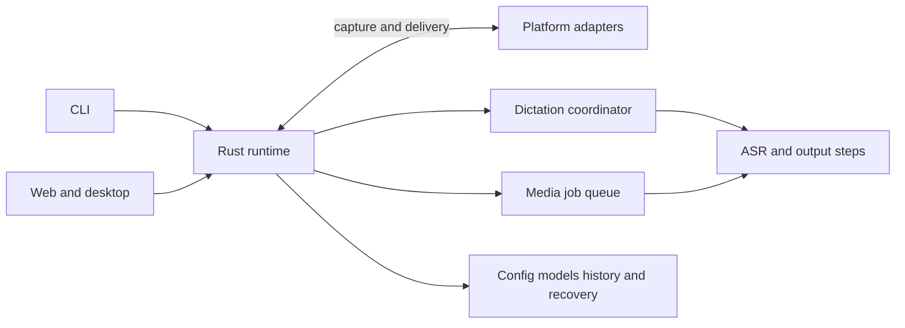

# Voiceless 全链路重构设计

## Context

发布基线为 `main` 上的 `v0.1.3`（`d2fb163`）。`vulkan` 的 `6290af1` 有可运行的控制台重设计，合并预检发现 `app.js` 的设备选项需要手工合并。Nix Vulkan 已由 `7247a46` 纳入 `main`，先在发布基线上集成重设计。 [发布记录](https://github.com/Vitus213/voiceless/releases/tag/v0.1.3) · [控制台提交](https://github.com/Vitus213/voiceless/commit/6290af1)

现有 `coordinator` 持有实时会话，`daemon` 持有热引擎，D-Bus 和 axum 已能控制同一条会话。`WarmEngine::describe()` 读的是配置设备，Apollo 实际选中 Vulkan 时控制台仍显示 `auto`。设置页发送整节草稿，隔离验证中第二个草稿只改线程数也能覆盖先前保存的 Vulkan。 [实时架构](../../../docs/architecture.md) · [引擎状态](https://github.com/Vitus213/voiceless/blob/d2fb16300e5f94f47128067a8eb5b0c231da4678/rust/src/engine.rs#L158) · [设置保存](https://github.com/Vitus213/voiceless/blob/d2fb16300e5f94f47128067a8eb5b0c231da4678/rust/src/console/settings.rs#L111)

## Goals / Non-Goals

- Rust 运行时持有会话和资源，界面按照能力发现呈现操作。CLI、Web、浮层和桌面共享决策与数据。
- Linux 首次成套交付包含独立窗口和托盘，并可独立安装无 GUI 的核心包。后续验收包含 macOS、Windows 及需额外权限的采集能力。
- 以单机单用户及现有 Voiceless 数据目录为边界。保留无网络、无窗口和轻量安装路径，跨设备同步与被替换的 Type4Me 客户端沿用既有兼容边界。

## Decisions

### 1. 常驻服务和会话事件

沿用 `coordinator` 的收尾、背压与取消语义。把 `daemon` 的开始、停止、取消、重置和工作调度收敛为一个命令循环，按用户和规范化数据目录互斥。CLI、D-Bus、Web 和桌面接入同一操作，已有 CLI 信号和 JSON 行继续由此映射。无 daemon 的显式 CLI 模式复用会话协调器并检查资源归属。图形宿主或浏览器重开时向现有运行时请求状态。

快照包含运行实例、会话 ID、配置修订、阶段、确认文本和单调事件序号。事件续接跟不上时发送重同步信号，客户端重新读取快照，忽略其他实例及已处理序号。用幂等请求键和会话终止状态拒绝重复提交。交付结果无法确认时不自动重发，重贴由用户发起新操作。相比由各入口重复管理录音，这保留一套采集和交付语义。 [历史会话约束](../migrate-voiceless-native-streaming/specs/native-cli-streaming-recognition/spec.md) · [Hex 窗口生命周期](https://github.com/anomalyco/hex/blob/v3.4.0/docs/linux.md#one-hex-process)

### 2. 后端和模型报告真实状态

在现有模型加载后读取 `transcribe-cpp` 的 `Model::backend()` 和 `Model::device()`，合并 Sherpa CPU、云端模型与预览路径的信息。缓存生效设备，瞬时显存另作诊断。使用真实解码结果记录会话后端，避免从请求的 `auto`、显卡列表或日志反推。模型目录继续用校验过的版本与 `current` 指针，导入 GGUF 检查家族、文件标识和实际可加载性。 [GGUF 入口](https://github.com/Vitus213/voiceless/blob/d2fb16300e5f94f47128067a8eb5b0c231da4678/rust/src/gguf_asr.rs#L53) · [transcribe-cpp 0.4.0 Model](https://docs.rs/transcribe-cpp/0.4.0/transcribe_cpp/struct.Model.html)

选择设备和选择 ASR 服务分别记录。现行 CLI 默认 `cloud-realtime` 与批量 `cloud` 保留，首次设置把本地作为显式选项，并要求决定是否发送音频到已选的云端服务。回退只能在主后端接收音频前发生，硬件自动回退留在已选本地引擎内。 [本次 ASR 增量](./specs/asr/spec.md)

### 3. 设置修改和应用

保留 TOML 与 `toml_edit` 的注释及权限语义。每次编辑带不透明修订标识和改动字段，运行时用基线值与当前值三方比较。并发修改不同字段可合并，同字段冲突返回当前值和可重试草稿。协作写入者按配置路径串行读、校验和原子替换，手工编辑检测保存前可见的文件变化。密钥使用保留、替换、清除三种操作，响应与导出只含状态。

保存和生效使用两个状态。在空闲时验证候选模型、音频设备和快捷键，再切换生效句柄。资源不足以同时保留旧引擎时拒绝热切换，保留原引擎并提示可选设备或显式重启。较早的异步验证结果不能替换较新修订。对比直接重启服务，这能让活动会话完整结束。 [设置增量](specs/configuration-management/spec.md)

### 4. Web 前端和平台宿主

采用 TypeScript + Vite，按会话、设置、输出、历史和任务拆分现有 DOM 和样式，前端只持有草稿、路由及显示状态。HTTP/SSE 和其他入口共用 Rust 状态类型，测试覆盖旧 API 的字段与语义。构建工具锁定在 Nix 和发布 CI，浏览器产物嵌入核心二进制。原页面锚点映射到新导航。当服务未运行时，独立 Web 控制台提供已有历史和配置能力。

独立桌面采用 Tauri 2 薄宿主，复用同一套界面和经过验证的本机 API。宿主负责启动或聚焦窗口、托盘及平台权限入口，识别和采集仍归 Rust 运行时。将系统 WebView 和桌面库限制在独立桌面包。界面使用统一能力描述显示受支持的入口，沿用回环地址、精确 Host、令牌和同源写入边界。外部链接交给系统浏览器，脚本扩展不获得桌面宿主权限。直接采用 Rune 会增加第二套界面的迁移与驱动验证成本。 [Hex 平台能力接口](https://github.com/anomalyco/hex/blob/8766d096eb3c98a5b1a54cb966a6daa717bc839d/src/rune_ui/platform.rs#L1) · [Tauri 2 能力](https://v2.tauri.app/security/capabilities/)

Linux 先复用 PipeWire、systemd 用户服务、D-Bus、Portal、evdev 和 Fcitx5。按合成器能力使用协议或桌面适配查询焦点与输入来源，受支持时用 Fcitx5 预编辑和提交。不能可靠确认目标时保留结果，允许用户显式复制或重贴。macOS 用 CoreAudio 与系统授权，Windows 用 WASAPI 和本机快捷键与输入 API。可从 `cpal` 共用必要的采集接口，由平台适配承接权限和设备变化。现有 Linux 采集路径只有在设备切换、质量或延迟测试证明需要时才替换。 [Voiceless 平台计划](../../../docs/cross-platform-plan.md) · [Hex 的 Linux 边界](https://github.com/anomalyco/hex/blob/v3.4.0/docs/linux.md)

### 5. 输出、历史和后台任务

把现有模式、词库、替换、清理和外部处理组织为有序步骤。运行时按手动选择、可信应用规则、默认模式的顺序解析，在开始会话时固定选择。预览复用同一处理入口，但不持有目标窗口或注入能力。站点规则只使用获准提供的上下文。可执行扩展在权限受限的独立工作进程中运行，凭据、文件、网络和进程能力按授权限定。与在前端运行任意脚本相比，独立执行让故障可隔离和取消。 [Hex Output](https://github.com/anomalyco/hex/blob/8766d096eb3c98a5b1a54cb966a6daa717bc839d/src/rune_ui/output.rs#L1)

历史用现有 SQLite 增加版本、真实来源与保留策略。以时间和稳定 ID 做分页，中文用可验证的子串匹配并测量大库性能。文字改写或重转写保存新版本和采用状态。旧记录保留原文、音频引用与已有时间戳，新字段缺失时呈现未知。只删除 Voiceless 持有且已无引用的记录文件，失败恢复区单独设置空间和期限。

文件、历史重转写、会议后处理与基准使用统一后台队列。WAV 走现有解码，其他常用格式通过可检测的 FFmpeg 媒体适配进入同一 PCM 路径。按段提交可恢复结果，源文件不可用时在重新选择后核验内容。实时听写优先占用解码器，后台工作在受限的分段边界让出 CPU/GPU，不能及时让出的设备组合保持排队。会议独立占用采集来源并明确冲突，屏幕标注用各平台的屏幕捕获授权。录制结果和导出只按用户动作进入历史或其他应用。 [历史增量](specs/recognition-library/spec.md) · [后台队列](specs/transcription-jobs/spec.md) · [采集工作流](specs/capture-workflows/spec.md)

## Risks / Trade-offs

| 风险 | 处理与退出条件 |
|---|---|
| 多应用、系统服务及重连同时争用资源 | 运行时互斥和事件序号在多客户端用例中验证。重新启动和浏览器重连均不重放交付。 |
| Wayland 的前台窗口、键盘和托盘支持不一致 | Niri、支持的 wlroots、GNOME/KDE、X11 分列能力。平台测试逐项验证；目标无法核实时用户可复制。 |
| 模型预加载和队列占用显存 | 测量候选加载和背景分段对回归门禁的影响。容量不足时保留已生效模型和排队状态。 |
| 新桌面依赖抬高核心包 ABI | WebView 只进桌面包。核心包继续以 Jammy glibc 2.35 检查 ELF 和 CPU 基线，保留 x86-64 Vulkan 与 ARM64 CPU 验收。 |
| 日志、脚本和可选采集涉及私密数据 | 诊断默认去除正文及密钥，权限和传输范围按功能展示。脚本和媒体长任务可取消，恢复数据按独立策略清理。 |

## Migration Plan

1. 以 `main` 集成 `6290af1` 的界面布局，保留 `0.1.3` 的设备选项和 `voiceless web`，兼容原有 CLI、D-Bus、HOME/XDG 路径、模式和配置。持久 `asr` 规格以本次 delta 对齐现行 Rust，历史迁移 change 保持完整记录。 [既有 ASR 规格](../../specs/asr/spec.md) · [历史迁移](../migrate-voiceless-native-streaming/proposal.md)
2. 先交付可从原安装升级的 Linux 听写链路，完成实际设备、设置生效、试说、桌面窗口、托盘与所支持的实际输入交付。随后交付输出流程与历史，再交付媒体任务、macOS/Windows 与会议/标注。各组在进入下一组前验收核心行为，最终按整套能力验证。
3. 升级前在用户状态目录保留受限配置副本和一致历史备份。新属性按可识别版本迁移，保留未知历史字段的显示和原模型指针。旧程序不能读取新历史格式时，回滚使用升级前备份，并提供导出升级后新增结果的入口。
4. Nix 和系统托管服务走系统配置更新，Bun 委托当前全局安装，独立包保留校验过的上一版。进程切换等待空闲，桌面和核心分别检查版本。Windows x64 与 Apple Silicon macOS 先形成独立签名和安装验收路径，发布说明只宣布实测过的组合。 [现有发布与更新](https://github.com/Vitus213/voiceless/blob/d2fb16300e5f94f47128067a8eb5b0c231da4678/docs/non-nix-distribution.md#L56)

## Validation

| 验收面 | 完成证据 |
|---|---|
| 浏览器和桌面 | 干净安装从模型准备到试说和上屏。窄屏、键盘、读屏、断线重连、重复启动和关闭窗口后听写分别验证。 |
| 音频与设备 | Apollo 同一版本回放 RTX 3070 Vulkan 与无驱动 CPU，远程路径单独验证。记录实际识别、预览、回退及交付。 |
| 延迟与质量 | 保留真实云端 `quick` 的首字 p95 ≤ 1.0 秒、松手到终稿 p50 ≤ 0.6 秒与松手到注入 p99 ≤ 1.0 秒，内容 CER ≤ 0.02。本地采用预先记录的同设备、同语料基线。 |
| 配置与历史 | 两个旧草稿、非法变更、热切换失败、旧库查询、版本恢复与数据回滚均走用户入口。 |
| 长任务与扩展 | 活动听写遇到长文件、会议、重转写或基准任务时继续满足录音和延迟约束。验证脚本超时、权限拒绝与采集中断恢复。 |
| 交付与升级 | Nix、Bun、独立包和桌面安装器分别验证离线启动与回滚。没有硬件、桌面或云凭据的结果标为未验证。 |

[现有性能门禁](../migrate-voiceless-native-streaming/specs/live-recognition-latency/spec.md)
